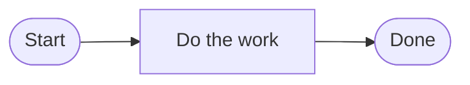

# Shortcodes and markup

Condensed from the Markup overview in the repository README. If this file and
the README disagree, the README wins. Update this file to match.

The docs are GitHub-flavored Markdown plus Hugo shortcodes. The shortcodes are
in `site/themes/arangodb-docs-theme/layouts/shortcodes/`. Use only the ones
there; don't invent new ones in content.

## `` or `{}`

- ``: the inner content is passed as is. Use it for most
  shortcodes (admonitions, tabs, steps, details, tag).
- `{}`: the output is rendered as Markdown. Use it where the
  shortcode emits Markdown: `card`, `llm-models`, `program-options`,
  `error-codes`, `exit-codes`, `metrics`, `optimizer-rules`,
  `service-versions`.

Match what existing pages use for the same shortcode.

To show a shortcode literally (in the README or inside another shortcode's
content), escape it: ``.

## Admonitions

Use sparingly. Pick the type by impact: `danger` (data loss or similar),
`warning` (restrictions to avoid issues), `security` (keeping the system and
data safe), `info` (helpful information), `tip` (best practices).

```markdown

Be careful and mind restrictions to avoid issues.

```

Inside another shortcode or an OpenAPI `description`, use the escaped form:
`...`. In OpenAPI descriptions, only one paragraph
is supported.

## Tabs

```markdown



...



...



```

The `tabs` parameter is a group ID: groups with the same ID switch together, so
they must use the same tab labels.

## Steps

```markdown



Any Markdown, including code blocks.



```

`step` takes `title`, optional `icon` (icon file name, lowercase/digits/hyphens)
and `id`. `steps` takes `titleSize` (`p` default, or `h2` to `h6` for semantic
headings). Invalid values fail the build.

## Cards

```markdown


{}
Learn everything about graphs.
{}


```

Note `{}` (percent signs) inside ``. `icon` is a file in
`site/content/images/`.

## Images

- Default: `` with a relative path.
- More control: ``.
- Compress images before merging (for example with Squoosh: reduce palette to
  64 colors, OxiPNG).
- Always write a meaningful `alt` / description.

## Icons

`Select all nodes (), then right-click.`

Icons supplement text; don't make them part of a sentence. Put the icon in
parentheses after the word that names the control. Files go in
`site/content/images/icons/`, referenced by name without extension (lowercase
letters, digits, and hyphens), with no `width`, `height`, `aria-hidden`, or
`focusable` on the `<svg>`. Check the folder for an existing icon before you
add one. A missing or invalid name fails the build.

## Static diagrams

For an SVG or PNG diagram that doesn't need clickable links, use `diagram`. It
renders an `` with an optional caption:

```markdown

```

`src` is an absolute path from the site root. Use `embed-svg` (below) when the
diagram has links or its text should be selectable.

## Embedded SVG diagrams

`` inlines
`site/content/images/Platform-Architecture.svg`, so links in it are clickable.
Pass `""` as the caption to suppress the default.

Inside the SVG:

- Links: `<a class="card-link" xlink:href="/arangodb/4.x/deploy/cluster/">`
  with absolute internal paths. External links use full URLs and
  `target="_blank"`.
- Put the visible `<text>` inside the `<a>`, so screen readers have a name.
- Order `<a>` elements like the layout (top to bottom, left to right, container
  before contents). This is the tab order.
- Scope `<style>` rules to a class on the top-level group. Inlined styles apply
  to the whole page.
- Style `:focus-visible` like `:hover`. On dark backgrounds set
  `--focus-ring: #befe99`.
- Leave at least 10px between adjacent links for the focus ring.
- Test by tabbing through in Chrome and Firefox.

## Mermaid diagrams

````markdown

````

Rendered in the browser, so syntax errors don't fail the build. Always check the
preview. Labels are plain text; for Markdown in a label, wrap it in backticks
inside the quotes (`` ["`**Bold**`"] ``) and use `<code>` for inline code.

## Other shortcodes

- Keyboard keys: ``.
- HTTP endpoint URL: `{{< endpoint "POST" "https://<HOST>:8529/_api/{GRAPH_ID}/action" >}}`.
  `{PARAM}` is a path parameter, `<PLACEHOLDER>` anything else to substitute.
- Hidden note: `...`.
- Collapsible: `...`.
  Use `summary="Show output"` to collapse long command output (HTTP headers,
  JSON responses) under the command that produces it.
- Video: ``, ``.
- Current patch version of a release series from `site/data/versions.yaml`:
  ``. Use it instead of hard-coding a patch version
  in URLs that should follow the latest release.
- Supported LLM and embedding models from `site/data/llm_models.yaml`:
  `{}` for the models all core services support, or
  `{}` (also `"autograph"`, `"retriever"`) for one
  service. The AutoRAG service ID is still `retriever`. Update the data file,
  not the pages.
- Generated lists (rarely needed): `{}`,
  `{}`, `{}`, `{}`,
  `{}`, `{}`.

Don't use in new content: `cloudbanner` (old AMP promotion with marketing
copy), and `button`, `children`, and `video`, which no page uses.
