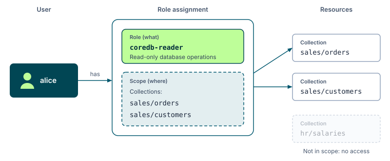
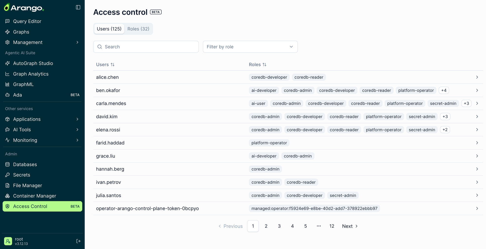
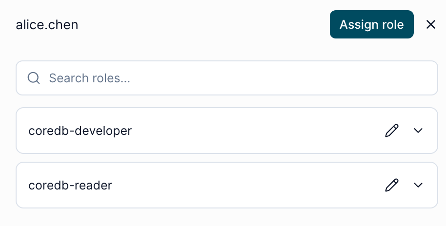
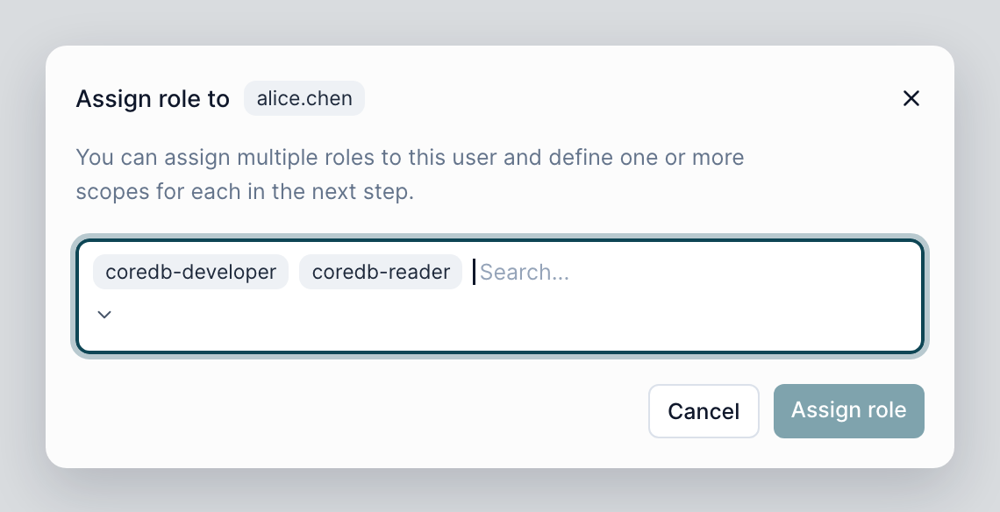
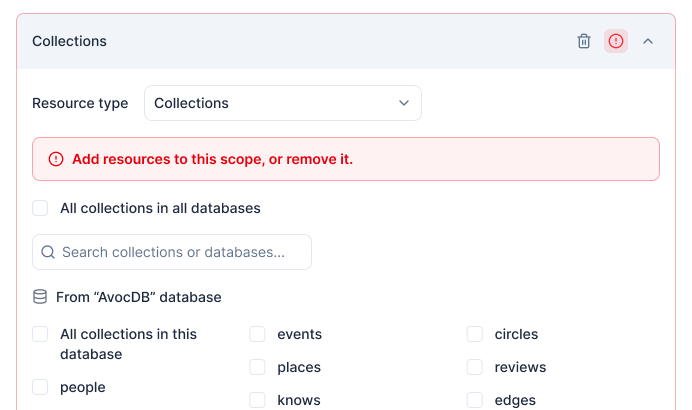
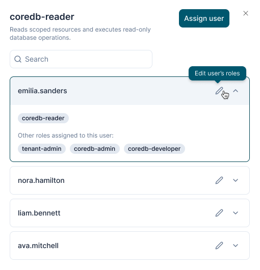

Role-based access control (RBAC) governs what every user of the
Arango Contextual Data Platform is allowed to do. Instead of granting
permissions to individuals one by one, you assign **roles** to users. Where a
role supports it, you can additionally narrow the assignment with one or more
**scopes** that say which resources the role applies to.

You manage all of this on the **Access Control** page in the **Admin**
section of the web interface of the Arango Contextual Data Platform.

## Concepts

- **User**:
  An account that authenticates against the data platform. **Nothing is
  permitted by default**, so a new user starts with no roles and no permissions.
  The exception is the built-in `root` account, which is bound to the
  all-powerful `super-admin` role automatically.

- **Role**:
  A named bundle of actions, such as `coredb-reader`, `ai-developer`, or
  `tenant-admin`. A role on its own describes *what* may be done. Users can
  hold multiple roles at the same time.

- **Scope**:
  A restriction attached to one role assignment that describes *where* the
  role applies. A scope is either **Everything** or a set of
  **specific resources**, selected per resource type as a single resource,
  several resources, or a name pattern. Not every role can be narrowed - some
  always apply everywhere.

An effective permission is therefore the combination of a user, a role, and
the scope of that assignment. Assigning the same role to two users with
different scopes gives them the same abilities over different data.



## The permission model

Users, roles, and scopes are the surface of a policy-based permission system
that the data platform evaluates on every request. You don't need to author its
objects to work with the Access Control interface, but knowing them explains
what an `Allow` and a `Deny` are, and how a scope takes effect.

Every request is reduced to who wants to do what, and where:

- The **user** the request is made on behalf of, taken from the token that
  [authenticates](authentication.md) it.
- The **action** to perform, named `<namespace>:<name>`, for example
  `db:Read` or `db:WriteData`. The `db` namespace holds the actions of the
  ArangoDB core database system.
- The **resource** to perform it on, for example a database
  (`db:database:<database>`) or a collection
  (`db:collection:<database>:<collection>`).

What may be done is expressed in **policies**. A policy is a list of
**statements**, and every statement combines an effect with the actions and the
resources it covers:

| Field | Description |
|--------|-------------|
| `effect` | Either `Allow` or `Deny`. These are the only two values |
| `actions` | The actions the statement applies to |
| `resources` | The resources the actions may be performed on |

Actions and resources both support wildcard patterns. They are matched per
`:`-separated segment, where a segment can be `*`, a prefix like `report_*`, a
suffix like `*_daily`, or an exact name. A trailing `*` segment also matches all
further segments. A `*` on its own thus matches everything, `db:*` matches every
action of the `db` namespace, and `db:collection:reports:*` matches every
collection of the `reports` database.

These objects form a chain from a user to the actions that user may perform:

1. A **policy** holds the statements.
2. A **role** is a named collection of policies. It is the unit you see in the
   web interface, such as `coredb-reader`.
3. A **role assignment** binds a role to a user and carries the **scope**. The
   scope is a policy as well.

### How a request is decided

For every request, the data platform matches the requested action and resource
against the statements that apply to the user:

1. Nothing is permitted by default. A request that no statement matches is
   denied.
2. Each assignment of the user is evaluated on its own. The statements of the
   role's policies are matched against the requested action and resource. A
   matching `Deny` denies the request for that assignment, a matching `Allow`
   grants it, and if nothing matches, the assignment contributes nothing. A
   `Deny` thus takes precedence over an `Allow` within an assignment.
3. The scope of the assignment has to allow the same action on the same
   resource. The effective permission of an assignment is the intersection of
   its role and its scope, so a role that allows an action still results in a
   denial if the scope does not cover the resource.
4. The request is permitted if at least one assignment allows it. Otherwise it
   is denied, and the service returns an error.

## How RBAC works in the data platform

The data platform runs on Kubernetes, and RBAC is part of its infrastructure:

- The ArangoDB Kubernetes Operator (`kube-arangodb`) manages the objects of the
  permission model as Kubernetes custom resources: policies
  (`ArangoPermissionPolicy`), roles (`ArangoPermissionRole`), role assignments
  (`ArangoPermissionRoleUserBinding`), and the identities of services
  (`ArangoPermissionToken`). It creates the predefined roles and keeps them up
  to date.
- The **central services** of the data platform provide authentication,
  authorization, metadata, and file storage to all other services. The central
  authorization service stores the policies, roles, and role assignments, and it
  serves the [HTTP API](#http-api) for managing them.
- Every service of the data platform runs with an **integration sidecar**, an
  additional container in the Kubernetes pod of the service. The sidecar
  validates the token of a request and decides whether the user is allowed to
  perform the action. It keeps a copy of the policies, roles, and role
  assignments that it synchronizes with the central authorization service,
  which is why changes take up to about 30 seconds to be enforced.
- Requests enter the data platform through the **gateway**, which
  authenticates them and passes the token of the user on to the service.
- Services that act on their own, for example, to run background jobs, have
  identities of their own. The operator creates a user and a token for each of
  them, together with a `managed:operator:<uuid>` role that grants only what
  the service needs.

RBAC is enforced at two levels:

- The services of the data platform, such as the Arango Control Plane (ACP)
  and AutoGraph, check the `ai:` actions that the
  [AI services roles](#ai-services-roles-in-detail) grant.
- The ArangoDB core database system checks the `db:` actions that the
  `coredb-*` roles grant, if you enable RBAC for ArangoDB, called
  ArangoDB RBAC in this documentation (see [Enable RBAC](#enable-rbac)).
  ArangoDB then asks the authorization sidecar of
  its pod for every decision. Otherwise, ArangoDB uses its
  [classic permissions](authorization.md).

## Enable RBAC

You enable RBAC with feature flags of the ArangoDB Kubernetes Operator
(`kube-arangodb`) in version 1.4.7 or later:

| Feature flag | Default | Description |
|---|---|---|
| `--deployment.feature.central-services` | Disabled | Runs the central services and evaluates the permissions of every request, but in permissive mode, which allows all requests |
| `--deployment.feature.rbac-enforced` | Disabled | Denies requests that the permissions don't allow |
| `--deployment.feature.rbac-coredb` | Disabled | Enables RBAC for the ArangoDB core database system, so that the `coredb-*` roles apply instead of the classic permissions. Requires the two flags above |


TODO: Verify the complete set of flags with the kube-arangodb team.
`central-services` depends on `gateway-sidecar`, which depends on
`jwt-asymmetric-key` (both disabled by default) and `jwt-rotation` and
`gateway` (enabled by default). Dependencies are not enabled automatically.
Also clarify whether the data platform will enable RBAC by default.


The flags result in the following modes:

| `central-services` | `rbac-enforced` | Mode | Behavior |
|---|---|---|---|
| Disabled | – | Always | No permission checks, all requests are allowed |
| Enabled | Disabled | Permissive | Permissions are evaluated, but all requests are allowed. Requests that would be denied are logged |
| Enabled | Enabled | Enforced | Requests that the permissions don't allow are denied |

The permissive mode doesn't protect anything. It is a step for introducing RBAC
in an existing deployment: assign roles to your users, check the logs of the
sidecar containers for requests that would be denied, adjust the role
assignments, and enforce RBAC once nothing legitimate would be denied anymore.

To enable RBAC in enforced mode, add the flags to the arguments of the operator
when you install or upgrade it with Helm, for example:

```sh
VERSION_OPERATOR='1.4.7' # Use a newer version if available

helm upgrade --install operator \
  --namespace arango \
  "https://github.com/arangodb/kube-arangodb/releases/download/$VERSION_OPERATOR/kube-arangodb-enterprise-$VERSION_OPERATOR.tgz" \
  --set "webhooks.enabled=true" \
  --set "operator.args[0]=--deployment.feature.gateway=true" \
  --set "operator.args[1]=--deployment.feature.central-services=true" \
  --set "operator.args[2]=--deployment.feature.rbac-enforced=true" \
  --set "operator.args[3]=--deployment.feature.rbac-coredb=true" \
  --set "operator.architectures={amd64}"
```

RBAC also requires authentication to be enabled for the deployment.

The operator implements `rbac-coredb` by starting the ArangoDB servers with the
`--server.external-rbac-service` startup option. Enabling it also changes which
permissions users need to work with their data through the AI services, see
[Access to the data in ArangoDB](#access-to-the-data-in-arangodb).


The `rbac.enabled` setting of the Helm chart of the operator is unrelated. It
controls the Kubernetes RBAC permissions of the operator itself, not the RBAC
of the data platform.


## Available roles

When RBAC is enabled, there is a set of **predefined roles** that you cannot
edit or delete. What you configure is which users hold which roles, and how each
of those assignments is scoped. Creating custom roles is not supported at this
time.

The predefined roles are automatically created and managed by the
ArangoDB Kubernetes Operator (`kube-arangodb`).

Every predefined role is named under the reserved `managed:predefined:` prefix,
for example `managed:predefined:coredb-reader`. The web interface lists the
short name, `coredb-reader`, whereas the API and the Kubernetes resources
expect the fully qualified name.

| Role | Purpose |
|------|---------|
| `super-admin` | Full access. Reserved - bound automatically to the `root` user and not assignable |
| `tenant-admin` | Manages users and role bindings |
| `coredb-reader` | Read-only database operations on scoped resources |
| `coredb-developer` | Read and write database operations on scoped resources |
| `coredb-admin` | Manages the structure and lifecycle of scoped resources |
| `ai-user` | Uses the AI services and reads their results, for example, runs AutoRAG queries and views the state of AutoGraph projects, in the scoped databases and shared services |
| `ai-developer` | Installs, configures, and runs the AI services in the scoped databases and shared services, and reads secrets |
| `platform-operator` | Operates the data platform and bundled services, views observability, starts containers |
| `secret-admin` | Creates, changes, and deletes the secrets that the AI services use, such as API keys of LLM providers |


`super-admin` is reserved. `kube-arangodb` binds it to the deployment's `root`
user automatically and rejects any attempt to assign it to somebody else, so
it appears in the lists with `root` as its holder but cannot be handed out.


For the endpoints of the ArangoDB core database system, the
[HTTP API documentation](../../arangodb/4.x/develop/http-api/_index.md) lists
which predefined roles grant access to each endpoint, in the
**Role-based access control (RBAC)** box below the endpoint URL.

The data platform denies everything by default. A role grants nothing until it
is assigned to a user together with a scope, and a user's effective permissions
are the union of all of their assignments, evaluated as described in
[The permission model](#the-permission-model).

Alongside the predefined catalog, the data platform generates a role per
Kubernetes operator-managed identity, named `managed:operator:<uuid>`. These
appear in the Access Control lists like any other role, together with the service
accounts that hold them, such as `operator-arango-control-plane-token-<id>`.
They are maintained by the data platform, so leave them untouched.

## AI services roles in detail

The `ai-user`, `ai-developer`, and `secret-admin` roles grant the actions of the
services of the Agentic AI Suite and the Arango Control Plane (ACP). As with
every role, the role describes what a user may do, and the scope of the role
assignment decides where.

### Resources of the AI services

The AI services check their actions on the following kinds of resources:

| Resource | Resource type in the web interface | Description |
|---|---|---|
| `ai:database:<database>` | Databases | A database, its projects, and the database services installed for it |
| `ai:service:<service-type>` | Shared services | A type of shared service, for example, `ai:service:arangodb-gral` for Graph Analytics |
| `ai:secret:store` | Secrets | All secrets as one resource. Secrets cannot be scoped individually |

Most AI services are **database services**: you install them for a specific
database, like AutoGraph, the Importer, AutoRAG, Natural Language to AQL, and
the Reasoner with its MCP server. All of their actions are checked on that
database. Projects are not resources of their own either. If the scope of your
role assignment covers a database, it covers all of its projects and the
database services installed for it.

**Shared services** are services that are not bound to a database, such as
the following:

- [Notebook servers](../notebook-servers.md)
- [Container Manager](../container-manager/_index.md) services, including the
  ones that you install for a specific database
- [Graph Analytics](../graph-analytics/_index.md) engines
- MLflow
- [GraphML](../graphml/_index.md)

They are checked on their service type rather than a database. A shared service
accesses ArangoDB with the permissions of the user who uses it, so having a
shared service in your scope lets you start and use the service, but it doesn't
grant access to any data. Other types of shared services are installed by the
data platform itself, and the AI roles don't let you manage them.

Shared services are not the same as the
[central services](#how-rbac-works-in-the-data-platform) of the
data platform's infrastructure.

### What the AI roles grant

{}

The services link to their RBAC pages if they have one. These pages describe the
actions in detail and which action each endpoint requires.

Keep the following rules in mind when you assign the AI roles:

- `ai-user` lets you use the AI services and read their results, whereas
  `ai-developer` additionally lets you install, configure, and run them, for
  example, to build a knowledge graph with AutoGraph.
- Neither `ai-user` nor `ai-developer` lets you create, change, or delete
  secrets. This requires the `secret-admin` role. `ai-developer` lets you read
  secrets, which you need to select an API key when you configure a service,
  but only if the scope includes the secrets. To let a developer also manage
  secrets, assign both `ai-developer` and `secret-admin`.
- The AI roles don't grant access to the data in ArangoDB. To access the data
  directly, for example, to explore the graph that AutoGraph creates or to run
  AQL queries, you additionally need a `coredb-*` role, or classic permissions if
  ArangoDB RBAC is disabled. See
  [Access to the data in ArangoDB](#access-to-the-data-in-arangodb).
- You don't need to grant anything for the File Parser, the internal service
  that converts documents for AutoGraph and the Importer. They use it with
  their own service identity.


Notebook servers, Container Manager services, and Graph Analytics engines don't
check AI actions for requests to their own endpoints. Who can install, list,
and uninstall them is controlled by the Arango Control Plane, based on the
shared service types in the scope. What the code in a Container Manager service
is allowed to do is up to your code. Call the APIs of the data platform with the
token of the user who called your service, never with the service's own token,
so that the permissions of that user apply.



TODO: Verify for notebook servers and Graph Analytics engines with the
respective teams. The source docs only cover the Container Manager
(arangoml/user_defined_service docs/RBAC.md).


### Access to the data in ArangoDB

The AI roles don't grant access to the data in ArangoDB. Whether you need
permissions for the data in addition depends on the AI service and on whether
ArangoDB RBAC is enabled (the `rbac-coredb` flag, see
[Enable RBAC](#enable-rbac)).

AI services that build or change data, like AutoGraph and the Importer, work
differently depending on whether ArangoDB RBAC is enabled:

- **ArangoDB RBAC disabled**: They read and write the collections of a
  project with your token. In addition to an AI role, you need classic permissions for
  the database, typically read/write access.
- **ArangoDB RBAC enabled**: They work in ArangoDB with their own service
  identity, which can only access the collections of the project. You only need
  an AI role to use them.

AI services that query your data always do so with your token, in both cases:
[AutoRAG](../autorag/rbac.md),
[Natural Language to AQL](../natural-language-to-aql/rbac.md), and the tools of
the MCP server that the [Reasoner](../reasoner/rbac.md) manages. In addition
to an AI role, you need read access to the database, with a `coredb-*` role if
ArangoDB RBAC is enabled, or a classic permission otherwise. The same applies
whenever you want to access the data directly, for example, to explore a graph
or run AQL queries.

## Open the Access Control interface

In the main navigation of the data platform web interface, select
**Access Control** in the **Admin** section.

If Data Platform RBAC is turned off for the deployment, the page only shows
the notice *Data Platform RBAC is not enabled* with a link to the
instructions. See [Enable RBAC](#enable-rbac).

If Data Platform RBAC is on but ArangoDB RBAC is not, a banner points out that
*ArangoDB roles are not enforced yet*. You can still assign the `coredb-*`
roles, but they grant nothing until ArangoDB RBAC is enabled for the
deployment.

The page has two tabs that show the same information from two directions:

- **Users**, listing every account and the roles it holds. See
  [List the roles of a user](#list-the-roles-of-a-user).
- **Roles**, listing every role and the users that hold it. See
  [List the roles](#list-the-roles).

Both tab labels include a count, for example **Users (5)** and **Roles (10)**.
Long lists are split into pages, with **Previous** and **Next** controls below
the table. Which tab you start from only decides the direction of the
assignment - both end in the same dialog.

## List the roles of a user




The **Users** tab shows a table with a **Users** column and a **Roles** column.
Both carry a sort toggle next to the header label. Each row lists the roles of
that user as chips:



- A user with no roles shows a hyphen (`-`).
- The `root` user shows the reserved `super-admin` role.
- If not all chips fit, the row shows as many as it can, followed by a chip
  with the number of remaining roles, for example `+3`. Hover over this chip
  to see the remaining roles.

The list always contains at least the `root` user. It also includes inactive
users, and you can assign roles to them, too.

Above the table you get a **Search** field for user names and a
**Filter by role** dropdown. You can select several roles in it, and type to
search the list of roles. The table then only shows users that hold any of the
selected roles, and the tab label shows the number of matching users.

Select a row to open the details panel for that user on the right-hand side.
The panel is headed by the user name and an **Assign role** button. Below a
**Search** field for role names, it lists one card per assigned role. Each card
has a pencil icon that opens the role for editing, and a chevron that expands
the card to show the scope of the assignment, grouped by resource type and
database, or `Everything` if the assignment is not narrowed.



If the user has no roles yet, the panel shows an empty state instead, headed
*No roles assigned to this user*. It points out that the user has no access
until you assign a role, and offers an **Assign role** button.



```sh
curl -H "Authorization: Bearer <JWT>" \
  https://<EXTERNAL_ENDPOINT>:8529/_management/permissions/user/alice/role
```

The response lists the role assignments of the user, each with its scope:

```json
{
  "bindings": [
    {
      "role": "managed:predefined:coredb-reader",
      "scope": {
        "statements": [
          {
            "effect": "Allow",
            "resources": ["db:apiversion:*", "db:database:reports", "db:*:reports:*"],
            "actions": ["*"],
            "description": ""
          }
        ],
        "description": ""
      }
    }
  ]
}
```

See the [`GET /_management/permissions/user/{user}/role`](#get-the-role-assignments-of-a-user)
endpoint in the HTTP API reference for details.




## Assign a role to a user

The steps are the same for every role. Only the scope differs, see
[Scope a role assignment](#scope-a-role-assignment).




1. In the **Users** tab, select the user to open the details panel.
2. Select **Assign role**. The **Assign role to `<user>`** dialog opens. Its
   field already contains the roles the user holds.

   
3. Search for and pick one or more roles to add, then select **Assign role**.
   The **Assign roles to `<user>`** dialog opens, with the new roles added to
   the **Assigned** list on the left, together with any roles the user
   already holds.
4. Select an entry in the **Assigned** list to configure it on the right,
   below the role name and a description of the role. Depending on the role,
   you either [scope the assignment](#scope-a-role-assignment) or see a notice
   that the role applies everywhere.
5. To add more roles, use the **Add role** combobox at the top of the
   **Assigned** list.
6. Select **Save changes**. A **Roles updated** notification confirms the
   change.

Each entry in the **Assigned** list shows the role name with the number of
scopes underneath, for example `2 scopes`, or `No scope yet` for a role you
have not scoped yet.

**Cancel** discards every change made in the dialog. If you have unsaved
changes, a **Discard changes?** prompt appears first. Select
**Discard changes** to close the dialog, or **Keep editing** to return to it.
The same applies if you close the dialog with the close icon or the Escape key.



```sh
curl -X POST -H "Authorization: Bearer <JWT>" \
  https://<EXTERNAL_ENDPOINT>:8529/_management/permissions/user/alice/role/managed:predefined:coredb-reader \
  -d '{"scope":{"statements":[{"effect":"Allow","actions":["*"],"resources":["db:apiversion:*","db:database:reports","db:*:reports:*"]}]}}'
```

This assigns the `coredb-reader` role to the user `alice` and limits it to the
`reports` database and everything in it. See
[Scopes in the HTTP API](#scopes-in-the-http-api) for how to express a scope.

See the [`POST /_management/permissions/user/{user}/role/{role}`](#create-a-role-assignment)
endpoint in the HTTP API reference for details.




## Assign a user to a role




Working from the Roles tab reverses the direction and adds a user-picking step
in front:

1. In the **Roles** tab, select the role to open the details panel.
2. Select **Assign user**. The **Assign a user** dialog opens, prompting you to
   *Pick the user to give this role to. You can define its scope in the next
   step.*
3. Choose an account from the **Search users** combobox. Users that already
   hold this role are listed under **Already assigned** and cannot be
   selected. **Next** stays disabled until you pick an available user.
4. Select **Next**. The **Assign roles to `<user>`** dialog opens with the role
   already in the **Assigned** list, and the flow continues exactly as in
   [Assign a role to a user](#assign-a-role-to-a-user).

This is only a different way to get to the same dialog. The result is the same
role assignment.



See [Assign a role to a user](#assign-a-role-to-a-user). There is no separate
HTTP API endpoint for assigning a user to a role.




## Scope a role assignment




With a role selected in the **Assigned** list, the right-hand side of the
dialog shows what that assignment can be narrowed to.

Some roles cannot be narrowed at all. For those, the panel shows the notice
*This role applies everywhere. It cannot be narrowed to specific resources
because it's a platform-level role.*
and the assignment covers all resources. This is the case for the
`managed:operator:<uuid>`, `tenant-admin`, and `platform-operator` roles.

For a role that supports scoping, neither option is selected when you add the
role. Choose between:

- **Everything**: the role applies to all resources that its policies cover,
  including resources created in the future.
- **Specific resources**: the role applies only to the resources you list,
  defined as one or more scopes.

Selecting **Specific resources** adds a first scope card. To add more, use
the **Add scope** button next to the role name. A new card is titled
**New scope** until you choose a **Resource type**, after which it takes the
name of that type. Which resource types are available depends on the role.
Each resource type except `Name pattern (advanced)` can only be added once
per role assignment. Types that are already in use are listed under
**Already scoped** and cannot be picked again. To change a scope, edit
the existing card. Each card can be collapsed with the chevron and removed
with the trash icon.

Below the **Everything** and **Specific resources** options, a **Visual** /
**JSON** toggle switches between the form-based configuration and a
read-only preview of the scope as JSON, in the format that the
[HTTP API](#scopes-in-the-http-api) uses. You can only edit the scope in the
**Visual** mode. The copy icon copies the JSON to the clipboard. The dialog
switches back to **Visual** mode when you switch between **Everything** and
**Specific resources**, select **Add scope**, select another role in the
**Assigned** list, or when **Save changes** finds an incomplete scope, so that
you see the validation errors.



The scope is the `scope` object in the request body when you
[assign a role to a user](#assign-a-role-to-a-user) or
[edit an assignment](#edit-or-remove-an-assignment). It consists of
statements that list the resources the role applies to.

**Everything** corresponds to a single statement that allows all actions on
all resources. Use it for the roles that cannot be narrowed, too:

```sh
curl -X POST -H "Authorization: Bearer <JWT>" \
  https://<EXTERNAL_ENDPOINT>:8529/_management/permissions/user/carol/role/managed:predefined:tenant-admin \
  -d '{"scope":{"statements":[{"effect":"Allow","actions":["*"],"resources":["*"]}]}}'
```

For **Specific resources**, list the resources in the `resources` array of a
statement, as shown in [Scope a core database role](#scope-a-core-database-role)
and [Scope an AI services role](#scope-an-ai-services-role). See
[Scopes in the HTTP API](#scopes-in-the-http-api) for the rules.




### Scope a core database role




For the `coredb-*` roles, the available resource types are
**Databases**, **Collections**, **Views**, **Analyzers**, **Graphs**, and
**Name pattern (advanced)**.

**Select collections**

For the **Collections** resource type, the scope card shows a collection picker:

- **All collections in all databases** selects everything at once.
- A **Search collections or databases** field filters the list.
- Collections are grouped per database, for example
  **From "_system" database**, each group starting with an
  **All collections in this database** checkbox followed by the individual
  collections.

The **All collections in this database** checkbox of a database is checked
if all of its collections are selected, and shows a partially selected state
if only some are. **All collections in all databases** shows a partially
selected state until every database is fully selected.


Selecting collections does not give access to the database they belong to,
but every request to a collection requires access to its database, too.
A scope that only consists of a **Collections** resource type therefore denies
all requests.

Adding a **Databases** resource type for the database is not a solution because
it grants access to everything in the database, including all collections.
To limit a role to individual collections, use the HTTP API instead, as shown
in the cURL tab.



TODO: Web interface bug: a Collections scope lacks db:database:<db>, and a
Database scope adds db:{collection,view,analyzer,graph}:<db>:*. Revisit once fixed.


**Match resources by name pattern**

The **Name pattern (advanced)** resource type replaces the picker with a single
text field where you enter a full resource name with a wildcard. For example,
`db:collection:analytics:report_*` matches every collection of the `analytics`
database whose name starts with `report_`. You can also enter resources that
have no resource type of their own in the dialog, like a user account
(`db:user:<username>`). The pattern is used exactly as you enter it, so a
pattern in any other format, like `analytics/report_*`, matches nothing.
See [Scopes in the HTTP API](#scopes-in-the-http-api) for the format of
resource names.

Patterns are evaluated continuously rather than expanded once, so
**all future matches are included automatically**. Use this when the set of
resources grows over time and you do not want to revisit the assignment for
every new collection.



To limit a `coredb-*` role to individual collections, list the database and
the collections as resources, plus `db:apiversion:*`. The web interface adds
`db:apiversion:*` automatically, but you need to include it yourself when
using the HTTP API:

```sh
curl -X POST -H "Authorization: Bearer <JWT>" \
  https://<EXTERNAL_ENDPOINT>:8529/_management/permissions/user/alice/role/managed:predefined:coredb-developer \
  -d '{"scope":{"statements":[{"effect":"Allow","actions":["*"],"resources":["db:apiversion:*","db:database:analytics","db:collection:analytics:orders","db:collection:analytics:customers"]}]}}'
```

A name pattern is a resource with a wildcard in it. For example,
`db:collection:analytics:report_*` matches every collection of the `analytics`
database whose name starts with `report_`, including collections created
later:

```sh
curl -X POST -H "Authorization: Bearer <JWT>" \
  https://<EXTERNAL_ENDPOINT>:8529/_management/permissions/user/dave/role/managed:predefined:coredb-reader \
  -d '{"scope":{"statements":[{"effect":"Allow","actions":["*"],"resources":["db:apiversion:*","db:database:analytics","db:collection:analytics:report_*"]}]}}'
```

See [Scopes in the HTTP API](#scopes-in-the-http-api) for the resources you
can use.




### Scope an AI services role

For the `ai-user` and `ai-developer` roles, the scope decides which databases,
shared services, and secrets the role applies to. See
[Resources of the AI services](#resources-of-the-ai-services). A typical scope
covers one or more databases, plus the shared services and the secrets if the
user needs them.




With **Specific resources** selected, add one scope per resource type:

- **Databases**: Select **All databases**, which includes databases created in
  the future, or search for and select individual databases.
- **Shared services**: Select **All shared services, including new types**, or
  individual service types, such as **Notebook servers**, **Container Manager**,
  and **Graph Analytics**. The dialog offers the types of shared services that
  the policy of the role covers.
- **Secrets**: Covers all secrets. There is nothing to select because secrets
  cannot be scoped individually.

The dialog only offers the resource types that the policy of the role covers.

The `secret-admin` role only covers the secrets. Its assignment always applies
to all secrets, including ones added later, so there is nothing to narrow.
The dialog shows the notice *Covers the whole secret store* instead of the
**Everything** and **Specific resources** options, and the **Assigned** list
shows `Secret store` as its scope.



```sh
curl -X POST -H "Authorization: Bearer <JWT>" \
  https://<EXTERNAL_ENDPOINT>:8529/_management/permissions/user/bob/role/managed:predefined:ai-developer \
  -d '{"scope":{"statements":[
    {"effect":"Allow","actions":["*"],"resources":["ai:database:sales"]},
    {"effect":"Allow","actions":["*"],"resources":["ai:service:arangodb-notebook-images","ai:service:arangodb-gral"]},
    {"effect":"Allow","actions":["*"],"resources":["ai:secret:store"]}
  ]}}'
```

This assigns the `ai-developer` role to the user `bob` and limits it to the
`sales` database, notebook servers and Graph Analytics engines, and the
secrets. The web interface creates one statement per resource type in the same
way. See [Scopes in the HTTP API](#scopes-in-the-http-api) for the resources
you can use.




### Incomplete and invalid assignments




The dialog does not let you save incomplete assignments. When you select
**Save changes**, it flags the following:

- A role for which you selected neither **Everything** nor
  **Specific resources** shows **Scope required** with the hint
  *Choose Everything or Specific resources, or remove this role.*
- A role with no scope gets a warning icon in the **Assigned** list. Hovering
  it shows *Add scope and resources, or remove this role*.
- A role with a scope that has no resources gets the same icon. Hovering it
  shows *Add resources to each scope, or remove the empty ones.*
- A scope card without a resource type is titled **Empty scope**, outlined
  in red, and shows **Resource type required** with the hint
  *Pick a resource type, or remove this scope.*
- A scope card without any selected resource is outlined in red and shows the
  inline error *Add resources to this scope, or remove it.*

  

If you delete all scope cards of a role, the role is flagged right away as
**No scope yet**, with the hint *Add a scope with resources, or remove this
role.*

Resolve every flagged item, or delete it, before saving.



The HTTP API rejects a request with a missing scope, or with an action or
resource that is not well-formed, with an HTTP `400` error. It does not
check whether a scope is useful, however:

- An empty `statements` array is accepted but grants nothing.
- A statement without an `effect` is a `Deny` statement.
- The role name is not checked, so a misspelled role is assigned without
  an error but has no effect.




## Edit or remove an assignment




Open the details panel of a user and select the pencil icon on a role card.
The same dialog reopens as **Edit roles for `<user>`**, where you can:

- Add further roles with the **Add role** combobox.
- Change the scope of an assignment, where the role supports it.
- Remove a role from the user with the trash icon on its entry in the
  **Assigned** list. The role is removed from the list right away. If the user
  held the role before you opened the dialog, a confirmation appears when you
  select **Save changes**. Confirm it to remove the role and all its scopes.
  The button reads **Delete role** or **Delete roles**, or
  **Delete role and save changes** if you made other changes, too.

  

If you remove every role, the dialog shows *No roles assigned to this user*
with an **Assign role** button to start over.

Select **Save changes** to apply the changes. A **Roles updated** notification
confirms them.

The pencil icons in the Roles tab panel work the same way, so you can adjust a
user's assignment from either direction without switching tabs. The dialog
opens with the role you came from selected. If you remove that role, the user
is no longer listed in the panel of the role.



To change the scope of an existing assignment, replace it as a whole:

```sh
curl -X PUT -H "Authorization: Bearer <JWT>" \
  https://<EXTERNAL_ENDPOINT>:8529/_management/permissions/user/alice/role/managed:predefined:coredb-reader \
  -d '{"scope":{"statements":[{"effect":"Allow","actions":["*"],"resources":["*"]}]}}'
```

To remove a role from a user:

```sh
curl -X DELETE -H "Authorization: Bearer <JWT>" \
  https://<EXTERNAL_ENDPOINT>:8529/_management/permissions/user/alice/role/managed:predefined:coredb-reader
```

See the [`PUT /_management/permissions/user/{user}/role/{role}`](#replace-the-scope-of-a-role-assignment)
and [`DELETE /_management/permissions/user/{user}/role/{role}`](#delete-a-role-assignment)
endpoints in the HTTP API reference for details.




## List the roles




The **Roles** tab lists every role in a table with two sortable columns:

| Column | Description |
|--------|-------------|
| `Roles` | The role name |
| `Users` | The users that hold the role as chips, or `-` if nobody does |

Above the table you get a **Search** field for role names and a
**Filter by user** dropdown that narrows the list to the roles of the selected
users.

Select a row to open the details panel for that role. It is headed by the role
name, a description of the role, and an **Assign user** button. Below a
**Search** field for user names, it lists one card per user that holds the
role. The pencil icon on a user card (**Edit user's roles**) opens the
assignment dialog for that user, and the chevron expands the card to show the
other roles of that user.





```sh
curl -H "Authorization: Bearer <JWT>" \
  https://<EXTERNAL_ENDPOINT>:8529/_management/permissions/role
```

The response contains the fully qualified role names, including the
`managed:operator:<uuid>` roles, and the total number of roles:

```json
{
  "names": [
    "managed:operator:3f6c0d2e-8a1b-4c5d-9e7f-1a2b3c4d5e6f",
    "managed:predefined:ai-developer",
    "managed:predefined:ai-user",
    "managed:predefined:coredb-admin",
    "managed:predefined:coredb-developer",
    "managed:predefined:coredb-reader",
    "managed:predefined:platform-operator",
    "managed:predefined:secret-admin",
    "managed:predefined:super-admin",
    "managed:predefined:tenant-admin"
  ],
  "page": {
    "items": 10,
    "page": 1
  }
}
```

The HTTP API has no endpoint for listing the users that hold a role.

See the [`GET /_management/permissions/role`](#get-all-roles) endpoint in the
HTTP API reference for details.




## When changes take effect

Changes to role assignments are not necessarily effective immediately,
regardless of whether you make them in the web interface or with the
HTTP API. Enforcement can take up to about 30 seconds. Keep that delay in mind
when verifying a change, and when revoking access that must take effect right
away.

## Troubleshoot denied access

The data platform's services do not silently drop actions a user is not allowed
to perform - they return an actionable error. If somebody reports being denied,
check two things in Access Control:

1. That a role granting the action is actually assigned to them.
2. That the **scope** of that assignment covers the resource they are working
   on. A correct role with too narrow a scope is the more common cause.

Remember that an assignment grants only what its role and its scope allow at
the same time, so a role that covers the action is still not enough if the
scope leaves the resource out. Also give a recent change time to propagate, as
[enforcement](#when-changes-take-effect) can lag by up to about 30 seconds.

Users can check whether they are allowed to perform an action on a resource
with the HTTP API, using their own session token. No particular role is
required for this:

```sh
curl -X POST -H "Authorization: Bearer <JWT>" \
  https://<EXTERNAL_ENDPOINT>:8529/_management/permissions/validate \
  -d '{"action":"db:WriteData","resource":"db:collection:reports:orders"}'
```

```json
{
  "message": "rpc error: code = PermissionDenied desc = Permission denied",
  "effect": "Deny"
}
```

Note that this checks a single action on a single resource, whereas a request
to the ArangoDB core database system involves multiple checks. For example,
writing a document into the `orders` collection of the `reports` database also
requires `db:UseApiVersion` on `db:apiversion:<version>` and `db:Read` on
`db:database:reports` and `db:collection:reports:orders`. An `Allow` for one
of them doesn't guarantee that the request succeeds.

The AI services check the action of the endpoint on a single resource, plus
further actions for some requests. Their error messages name the action and the
resource, for example, `Not permitted: ai:autograph.build on ai:database:sales`,
which you can check in the same way:

```sh
curl -X POST -H "Authorization: Bearer <JWT>" \
  https://<EXTERNAL_ENDPOINT>:8529/_management/permissions/validate \
  -d '{"action":"ai:autograph.build","resource":"ai:database:sales"}'
```

Common causes for denied access to the AI services are:

- The scope covers the database but not the secrets. Starting an AutoGraph
  orchestration and changing the model configuration of a service read secret
  profiles and therefore require `ai:secret:store` in the scope.
- The scope doesn't cover the shared service type, for example, when starting
  a notebook server or a Graph Analytics engine. Services of the
  Container Manager are always shared services, even if they are installed for
  a database.
- The user has `ai-developer` but tries to create or change a secret, which
  requires `secret-admin`.
- ArangoDB RBAC is disabled and the user lacks classic permissions for the
  database. AI services like AutoGraph then work with the user's token and
  return `403` with a message like `Database access denied`.
- The AI service works, but the user cannot see the resulting data in the web
  interface or with AQL queries. The AI roles don't grant access to the data in
  ArangoDB. Assign a `coredb-*` role as well.
- The service returns `500` with ArangoDB RBAC enabled. The service identity
  of the AI service lacks a permission. This is a problem of the deployment,
  not of the user's roles.

If nothing is ever denied, check whether RBAC is
[enforced](#enable-rbac) or runs in permissive mode.

See the
[`POST /_management/permissions/validate`](#check-a-permission) endpoint in the
HTTP API reference for details.

## HTTP API

You can manage role assignments with the HTTP API of the authorization service
of the data platform, which is what the web interface uses, too. Its endpoints
are available under `/_management/permissions/` on the data platform endpoint,
for example
`https://<EXTERNAL_ENDPOINT>:8529/_management/permissions/role`.

- **Authentication**: Send a [session token](authentication.md#obtain-a-session-token)
  in the `Authorization: Bearer <JWT>` HTTP header.
- **Permissions**: Of the predefined roles, only `super-admin` grants access
  to these endpoints, so use a session token of the `root` user (or a
  [superuser token](authentication.md#superuser-tokens)).
  
  Every endpoint requires an action of the `rbac` namespace, such as
  `rbac:AssignUserRole`, which only `super-admin` grants. The
  `POST /_management/permissions/validate` endpoint requires none.
  
- **Role names**: The endpoints expect the fully qualified role names, such as
  `managed:predefined:coredb-reader`. The authorization service does not check
  whether a role exists when you assign it, so double-check the spelling.
- **Propagation**: Changes are enforced after up to about 30 seconds, as
  described in [When changes take effect](#when-changes-take-effect).
- **Errors**: Error responses have a JSON body with a numeric `code`, a
  `message`, and a `details` array. The `code` is a gRPC status code, not the
  HTTP status code.

### Scopes in the HTTP API

The scope of a role assignment is a policy, an object with a `statements` array.
Each statement has an `effect`, a list of `actions`, and a list of `resources`.
A role assignment grants an action on a resource only if both the role and the
scope allow it. The scope can therefore restrict the actions as well as the
resources, but you typically allow all actions in the scope and restrict the
resources:

```json
{
  "statements": [
    {
      "effect": "Allow",
      "actions": ["*"],
      "resources": ["db:apiversion:*", "db:database:reports", "db:*:reports:*"]
    }
  ]
}
```

- Set the `effect` explicitly. If you omit it, it defaults to `Deny`.
- **Everything** corresponds to `"actions": ["*"]` and `"resources": ["*"]`.
- Each role assignment has its own scope, which only applies to the role of
  that assignment. For example, to let a user work with the AI services and
  query the data of the `sales` database, both the `ai-user` and the
  `coredb-reader` assignment need a scope that covers the `sales` database, with
  the respective resources.
- The ArangoDB core database system checks the `db:UseApiVersion` action on the
  `db:apiversion:<version>` resource for every request. Include
  `db:apiversion:*` in every scope for the `coredb-*` and `tenant-admin` roles,
  or the scope denies all ArangoDB requests. The AI services roles don't need
  it.
- Access to anything in a database also requires the database itself, for
  example `db:database:reports`. `db:*:reports:*` covers the collections,
  Views, Analyzers, and graphs of the `reports` database, and
  `db:collection:reports:orders` a single collection.
- User accounts are resources of the form `db:user:<username>`.
- Administrative actions, such as creating backups, do not operate on a
  specific resource. Only a scope with the `*` resource covers them.
- The resources of the AI services are `ai:database:<database>` for a
  database, `ai:service:<service-type>` for a type of shared service, and
  `ai:secret:store` for the secrets. `ai:database:*` covers all databases and `ai:service:*` all
  shared services. See
  [Resources of the AI services](#resources-of-the-ai-services).
- The names of databases and service types in `ai:` resources cannot contain
  `:` or `*`. Besides an exact name, you can use a prefix pattern like
  `ai:database:sales_*`.

### Get all roles

```openapi
---
service: rbac
---
paths:
  /_management/permissions/role:
    get:
      operationId: listRbacRoles
      # Hidden until the rbac:* actions are documented: requires the rbac:ListRole action
      description: |
        Returns the names of all roles, including the predefined roles and the
        roles that the data platform maintains for its own identities.
      parameters:
        - name: page
          in: query
          required: false
          description: |
            The page of results to return, starting at `1`. If you set it to
            `0`, the response contains no role names but only the total number
            of roles.
          schema:
            type: integer
            default: 1
        - name: items_per_page
          in: query
          required: false
          description: |
            The maximum number of role names per page.
          schema:
            type: integer
            default: 128
      responses:
        '200':
          description: |
            The role names.
          content:
            application/json:
              schema:
                type: object
                properties:
                  names:
                    description: |
                      The fully qualified names of the roles on the requested page.
                    type: array
                    items:
                      type: string
                  page:
                    description: |
                      Information about the pagination.
                    type: object
                    properties:
                      items:
                        description: |
                          The total number of roles.
                        type: integer
                      page:
                        description: |
                          The returned page.
                        type: integer
        '401':
          description: |
            The request does not contain a valid token.
        '403':
          description: |
            The user of the token is not permitted to use this endpoint.
        '503':
          description: |
            The authorization service is not ready.
```

### Get the role assignments of a user

```openapi
---
service: rbac
---
paths:
  /_management/permissions/user/{user}/role:
    get:
      operationId: listRbacUserRoleBindings
      # Hidden until the rbac:* actions are documented: requires the rbac:ListUserRoleBinding action
      description: |
        Returns the roles assigned to a user, together with the scope of each
        assignment.
      parameters:
        - name: user
          in: path
          required: true
          description: |
            The name of the user.
          schema:
            type: string
      responses:
        '200':
          description: |
            The role assignments of the user. The list is empty if the user has
            no roles or doesn't exist.
          content:
            application/json:
              schema:
                type: object
                properties:
                  bindings:
                    description: |
                      The role assignments.
                    type: array
                    items:
                      type: object
                      properties:
                        role:
                          description: |
                            The fully qualified name of the role.
                          type: string
                        scope:
                          description: |
                            The scope of the assignment.
                          type: object
                          properties:
                            statements:
                              description: |
                                The statements of the scope.
                              type: array
                              items:
                                type: object
                                properties:
                                  effect:
                                    description: |
                                      Whether the statement allows or denies.
                                    type: string
                                    enum: [Allow, Deny]
                                  actions:
                                    description: |
                                      The action patterns.
                                    type: array
                                    items:
                                      type: string
                                  resources:
                                    description: |
                                      The resource patterns.
                                    type: array
                                    items:
                                      type: string
                                  description:
                                    description: |
                                      An optional description of the statement.
                                    type: string
                            description:
                              description: |
                                An optional description of the scope.
                              type: string
        '400':
          description: |
            The user name is empty.
        '401':
          description: |
            The request does not contain a valid token.
        '403':
          description: |
            The user of the token is not permitted to use this endpoint.
        '503':
          description: |
            The authorization service is not ready.
```

### Create a role assignment

```openapi
---
service: rbac
---
paths:
  /_management/permissions/user/{user}/role/{role}:
    post:
      operationId: createRbacUserRoleBinding
      # Hidden until the rbac:* actions are documented: requires the rbac:AssignUserRole action
      description: |
        Assigns a role to a user, restricted to the given scope.
      parameters:
        - name: user
          in: path
          required: true
          description: |
            The name of the user.
          schema:
            type: string
        - name: role
          in: path
          required: true
          description: |
            The fully qualified name of the role, for example
            `managed:predefined:coredb-reader`.
          schema:
            type: string
      requestBody:
        content:
          application/json:
            schema:
              type: object
              required:
                - scope
              properties:
                scope:
                  description: |
                    The scope of the assignment. See
                    [Scopes in the HTTP API](#scopes-in-the-http-api).
                  type: object
                  required:
                    - statements
                  properties:
                    statements:
                      description: |
                        The statements of the scope. An empty list grants
                        nothing.
                      type: array
                      items:
                        type: object
                        required:
                          - effect
                          - actions
                          - resources
                        properties:
                          effect:
                            description: |
                              Whether the statement allows or denies the actions
                              on the resources. Defaults to `Deny` if omitted.
                            type: string
                            enum: [Allow, Deny]
                          actions:
                            description: |
                              The action patterns, `*` or `<namespace>:<name>`,
                              for example `db:Read` or `db:*`.
                            type: array
                            items:
                              type: string
                          resources:
                            description: |
                              The resource patterns, for example
                              `db:database:reports` or `*`.
                            type: array
                            items:
                              type: string
                          description:
                            description: |
                              An optional description of the statement.
                            type: string
                    description:
                      description: |
                        An optional description of the scope.
                      type: string
      responses:
        '200':
          description: |
            The role has been assigned.
          content:
            application/json:
              schema:
                type: object
                properties:
                  user:
                    description: |
                      The name of the user.
                    type: string
                  role:
                    description: |
                      The fully qualified name of the role.
                    type: string
                  scope:
                    description: |
                      The scope of the assignment.
                    type: object
                  index:
                    description: |
                      The sequence number of the change.
                    type: integer
        '400':
          description: |
            The scope is missing or contains an invalid action or resource.
        '401':
          description: |
            The request does not contain a valid token.
        '403':
          description: |
            The user of the token is not permitted to use this endpoint.
        '409':
          description: |
            The role is already assigned to the user. Use the `PUT` method to
            change the scope.
        '503':
          description: |
            The authorization service is not ready.
```

### Replace the scope of a role assignment

```openapi
---
service: rbac
---
paths:
  /_management/permissions/user/{user}/role/{role}:
    put:
      operationId: replaceRbacUserRoleBinding
      # Hidden until the rbac:* actions are documented: requires the rbac:ReplaceUserRoleScope action
      description: |
        Replaces the scope of an existing role assignment.
      parameters:
        - name: user
          in: path
          required: true
          description: |
            The name of the user.
          schema:
            type: string
        - name: role
          in: path
          required: true
          description: |
            The fully qualified name of the role, for example
            `managed:predefined:coredb-reader`.
          schema:
            type: string
      requestBody:
        content:
          application/json:
            schema:
              type: object
              required:
                - scope
              properties:
                scope:
                  description: |
                    The new scope of the assignment, in the same format as for
                    [creating a role assignment](#create-a-role-assignment).
                    It replaces the previous scope entirely.
                  type: object
      responses:
        '200':
          description: |
            The scope has been replaced. The response has the same format as
            for creating a role assignment.
          content:
            application/json:
              schema:
                type: object
                properties:
                  user:
                    description: |
                      The name of the user.
                    type: string
                  role:
                    description: |
                      The fully qualified name of the role.
                    type: string
                  scope:
                    description: |
                      The new scope of the assignment.
                    type: object
                  index:
                    description: |
                      The sequence number of the change.
                    type: integer
        '400':
          description: |
            The scope is missing or contains an invalid action or resource.
        '401':
          description: |
            The request does not contain a valid token.
        '403':
          description: |
            The user of the token is not permitted to use this endpoint.
        '404':
          description: |
            The role is not assigned to the user. Use the `POST` method to
            assign it.
        '503':
          description: |
            The authorization service is not ready.
```

### Delete a role assignment

```openapi
---
service: rbac
---
paths:
  /_management/permissions/user/{user}/role/{role}:
    delete:
      operationId: deleteRbacUserRoleBinding
      # Hidden until the rbac:* actions are documented: requires the rbac:RemoveUserRole action
      description: |
        Removes a role from a user.
      parameters:
        - name: user
          in: path
          required: true
          description: |
            The name of the user.
          schema:
            type: string
        - name: role
          in: path
          required: true
          description: |
            The fully qualified name of the role, for example
            `managed:predefined:coredb-reader`.
          schema:
            type: string
      responses:
        '200':
          description: |
            The role has been removed from the user.
          content:
            application/json:
              schema:
                type: object
                properties:
                  user:
                    description: |
                      The name of the user.
                    type: string
                  role:
                    description: |
                      The fully qualified name of the role.
                    type: string
                  scope:
                    description: |
                      Always `null`.
                    type: 'null'
                  index:
                    description: |
                      The sequence number of the change.
                    type: integer
        '401':
          description: |
            The request does not contain a valid token.
        '403':
          description: |
            The user of the token is not permitted to use this endpoint.
        '404':
          description: |
            The role is not assigned to the user.
        '503':
          description: |
            The authorization service is not ready.
```

### Check a permission

```openapi
---
service: rbac
---
paths:
  /_management/permissions/validate:
    post:
      operationId: validateRbacPermission
      description: |
        Checks whether the user of the token is allowed to perform an action on
        a resource, based on the role assignments of the user.

        This evaluates a single action on a single resource. Requests to the
        ArangoDB core database system involve multiple such checks.
      # No rbac:* action required
      requestBody:
        content:
          application/json:
            schema:
              type: object
              required:
                - action
                - resource
              properties:
                action:
                  description: |
                    The action to check, for example `db:Read`.
                  type: string
                resource:
                  description: |
                    The resource to check, for example
                    `db:collection:reports:orders`.
                  type: string
      responses:
        '200':
          description: |
            The result of the check. This status code is also returned if the
            action is denied.
          content:
            application/json:
              schema:
                type: object
                properties:
                  effect:
                    description: |
                      Whether the action is allowed on the resource.
                    type: string
                    enum: [Allow, Deny]
                  message:
                    description: |
                      The reason for a denial. Empty if the action is allowed.
                    type: string
        '401':
          description: |
            The request does not contain a valid token.
        '503':
          description: |
            The authorization service is not ready.
```
