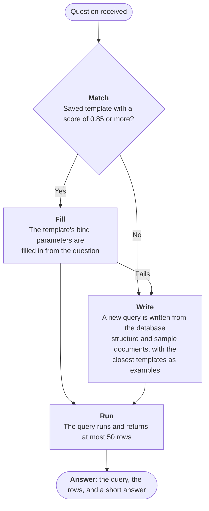
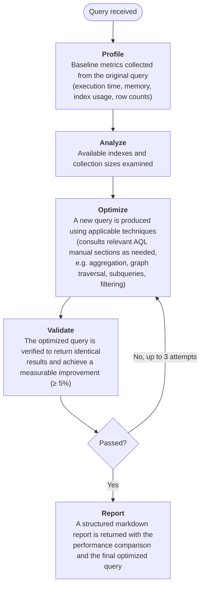
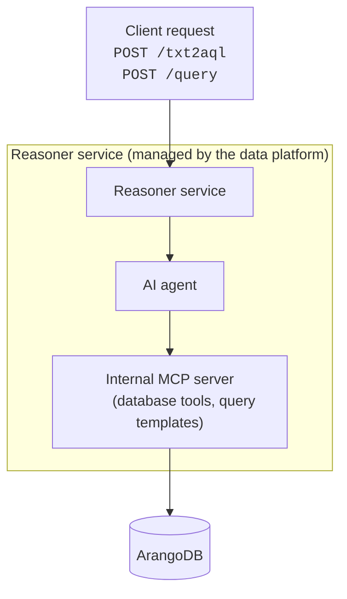



## Overview

The AQLizer turns questions in natural language into AQL queries and makes AQL
queries faster. It reasons about your database. It explores the collections,
graphs, and indexes with database tools, writes or rewrites a query, runs it,
and checks the result.

You can ask questions or give instructions like the following:

- "List all distinct surnames in the database sorted in descending order"
- "How many persons are there with the surname 'Stark'?"
- "What are the top 5 performing stores based on revenue?"

The AQLizer offers two operations:

- **Generate**: Ask a question in natural language and get an AQL query, the
  rows it returned, and a short answer.
- **Optimize**: Submit an AQL query and get a faster version that returns the
  same results, with a performance comparison report.

**Generate** aims at a correct answer, **Optimize** at a faster query. You can optimize
a query that the AQLizer generated, or one you wrote yourself.


Previously, the Query Editor had two separate features: the **AQLizer** tab
generated queries from questions using the
[Natural Language to AQL](../natural-language-to-aql/_index.md) service, and an
**Optimize** button opened a separate panel that used the Reasoner service.
Now the **AQLizer** tab does both, with **Generate** and **Optimize**, and both
run on one backend, the Reasoner service (`arangodb-reasoner`). This is why the
API uses the `/reasoner/` URL prefix. The Natural Language to AQL service is
deprecated, and the web interface no longer uses it.


## How the AQLizer works

### Generate a query

For a question in natural language, the AQLizer first looks for a saved query
template that matches the question. If it finds a close match, it adapts the
template to your question, mainly by filling in its bind parameters. If there
is no close match, or filling in the template fails, it samples the
collections, looks up values if needed, and writes a new query. Any templates
it found serve as examples. It then runs the query and returns the query, up to
50 result rows, and a short answer in natural language.

You can save a query as a template when you generate it. Over time, this
builds up a set of queries for the questions your users ask. When a new
question closely matches one of them, the AQLizer adapts the saved query
instead of sampling the database and writing a new one. See
[Save queries as templates](api-reference.md#save-queries-as-templates).


Query templates are only available through the API. The web interface does not
support them.


Generating a query can take tens of seconds, because the AQLizer explores the
database before it writes the query.

### Optimize a query

For a query to optimize, the AQLizer runs **Explain** and **Profile**, examines
the available indexes and collection statistics, and rewrites the query using
what it has learned. It tries alternative strategies, measures each attempt,
and keeps the best. If an attempt fails or does not improve the query enough,
it retries with a different approach, up to 3 times.

The pipeline runs through the following stages:

1. The original query is profiled to measure execution time, memory usage,
   index utilization, and rows scanned.
2. The indexes on the relevant collections are retrieved.
3. A new query is produced using applicable optimization techniques.
4. The rewritten query is validated before it runs, at no additional query
   cost.
5. Both queries run and their performance metrics are compared.
6. The optimized query has to return identical results, matching both row
   counts and data content.
7. If the improvement is below 5% or the results do not match, a new approach
   is tried, up to 3 attempts.
8. A markdown report is returned with a performance comparison table, what
   changed, why it is faster, and the final optimized query.

You can optimize the optimized query again. At some point, the AQLizer finds no
further improvement.

### Read-only queries

The AQLizer only runs read-only queries. It does not run a query that writes
data, for example with `INSERT`, `UPDATE`, `REPLACE`, `UPSERT`, or `REMOVE`:

- **Generate** answers a request to add, change, or delete data with an error.
- **Optimize** ends the request with the message
  `This is a write query. Only read-only queries can be optimized or run.`
- During validation, an optimization attempt that writes data is rejected.

The AQLizer runs queries with your token, so they are subject to your
permissions in the database.

## Architecture

The AQLizer runs on the Reasoner service (`arangodb-reasoner`). You start,
stop, and configure it as one unit, once per database, and one setup makes
both **Generate** and **Optimize** available.

The Reasoner service contains an AI agent that sends prompts to the language
model and decides which database tools to call. The tools come from an
internal MCP server that the data platform starts, connects, and stops along
with the AQLizer. The MCP server runs the database operations and also stores
and searches the query templates.


The internal MCP server used by the AQLizer is not the same as the
[ArangoDB MCP Server](../../ecosystem/arangodb-mcp-server.md). The latter is
a separately available container image with a more limited set of tools that
you can run yourself to connect AI assistants to ArangoDB. It is not required
for the AQLizer.


## Prerequisites

- A valid **Agentic AI Suite** license for your Arango Contextual Data Platform
  deployment.
- An **API key** for the language model the AQLizer uses. Both operations use
  the same key and model. See [Language model](#language-model).

## Language model

The AQLizer uses OpenAI with the `gpt-5.4-nano` model by default. It also
works with other providers, such as Anthropic, and with OpenAI-compatible
endpoints, such as a proxy or Azure OpenAI. The API key you provide has to
belong to the configured provider.

When you start the Reasoner service through the data platform API, you can set the
following parameters in its `env`:

| Parameter | Description |
|-----------|-------------|
| `chat_api_provider` | The provider ID, for example `openai` or `anthropic`. Default: `openai`. |
| `chat_model` | The model ID without a provider prefix, for example `gpt-5.4-nano`. Default: `gpt-5.4-nano`. |
| `chat_api_url` | The base URL of a proxy, Azure OpenAI, or another OpenAI-compatible endpoint. Leave it empty for the provider's default. |
| `chat_model_options` | Provider-specific model options as a JSON object. |
| `chat_secret_profile_id` or `chat_api_key` | The ID of a [Secrets Manager](../secrets-manager.md) secret that holds the API key, or the key itself. |

## How to access

- [Web Interface](web-interface.md): Generate and optimize queries in the
  **Query Editor** and open them in a query tab.
- [API Reference](api-reference.md): Call the AQLizer from your applications,
  with streaming and non-streaming responses.
