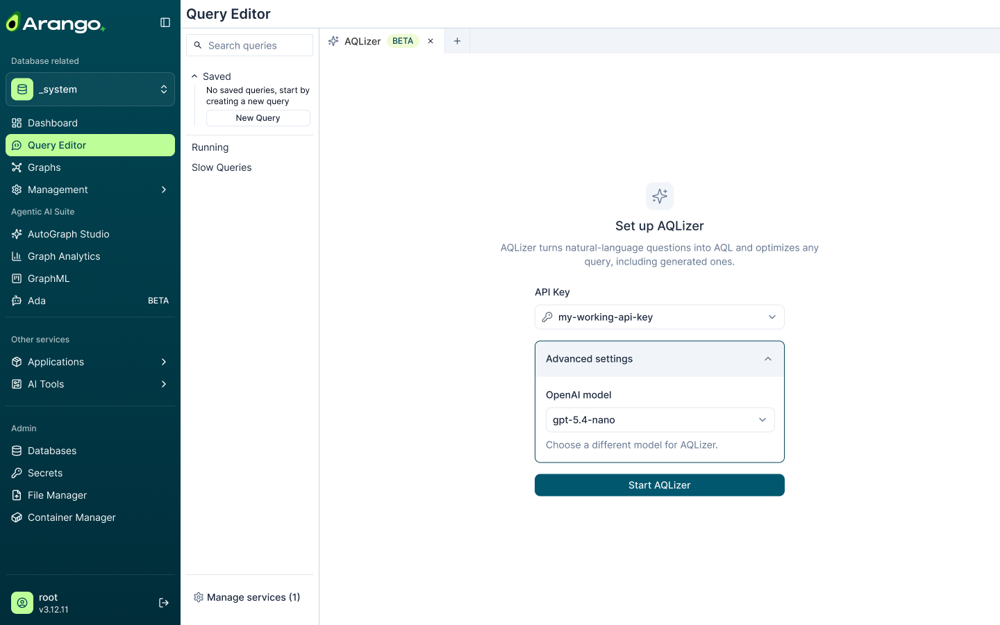
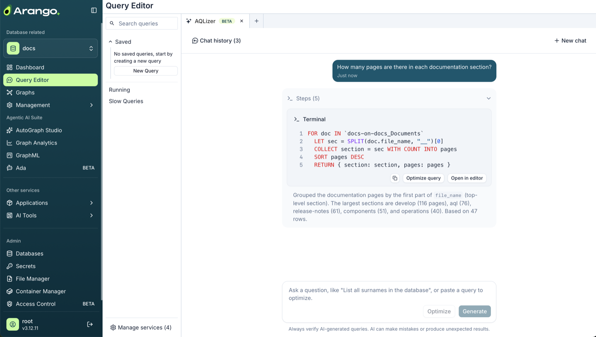
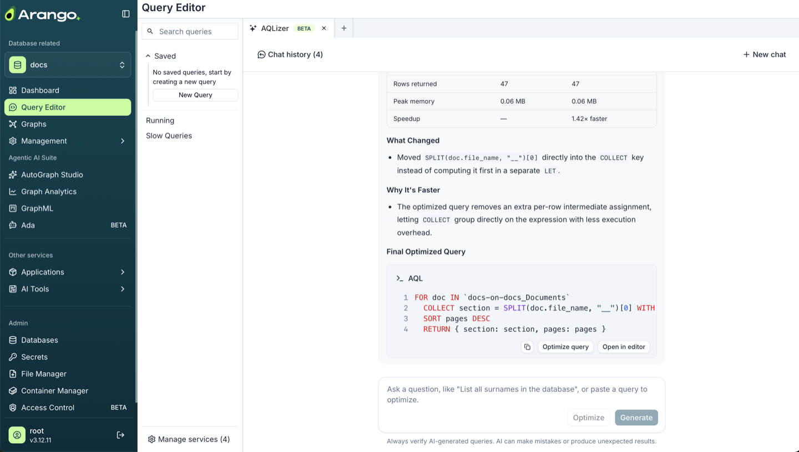
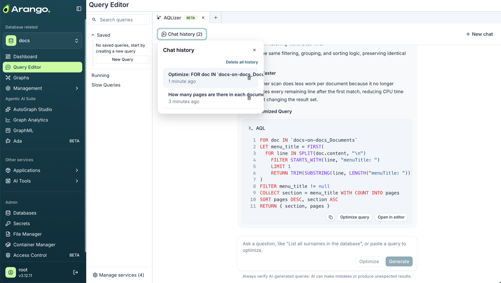
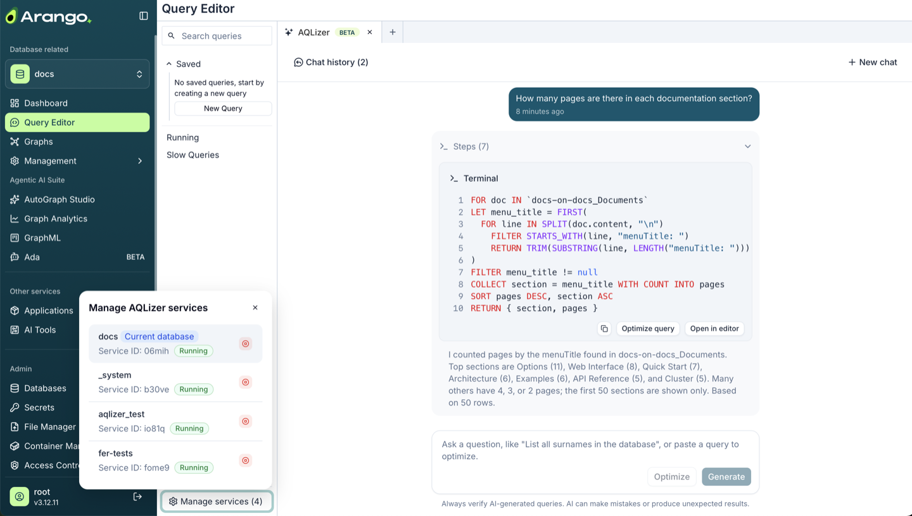



The AQLizer is part of the **Query Editor** of the Arango Contextual Data
Platform. It requires the Agentic AI Suite license.

## Open the AQLizer

1. In the sidebar, select the database you want to query and click
   **Query Editor**.
2. Open the **AQLizer** tab in one of these ways:
   - In the **Welcome** tab, click **Ask AQLizer**.
   - At the bottom of a query tab, click **Ask AQLizer**. The AQLizer tab
     opens next to the query, with the query copied into the input field.
     Nothing runs yet. Click **Optimize** to optimize the query, or replace it
     with a question and click **Generate**.

## Set up the AQLizer

You set up the AQLizer once per database. The setup makes both **Generate** and
**Optimize** available.

1. Under **API Key**, select a saved API key of your language model provider,
   or click **Add new secret** to save a new one in the
   [Secrets Manager](../secrets-manager.md).
2. Optional: Expand **Advanced settings** and select a different
   **OpenAI model**. The default is `gpt-5.4-nano`.
3. Click **Start AQLizer**. Starting takes a few seconds.

## Generate a query

1. Type a question about your data in the input field, for example
   *List all surnames in the database*.
2. Click **Generate**. The AQLizer shows its progress step by step. To cancel,
   click the stop button.
3. Review the generated query and the explanation below it.
4. Click one of the buttons below the query:
   - The copy button: Copy the query to the clipboard.
   - **Optimize query**: Make the generated query faster. See
     [Optimize a query](#optimize-a-query).
   - **Open in editor**: Open the query in a new query tab, where you can
     verify, change, and run it.

The AQLizer doesn't show the rows that the query returned. Run the query in
the editor to see them.

## Optimize a query

1. Start the optimization in one of these ways:
   - Below a generated query, click **Optimize query**.
   - Paste a query into the input field and click **Optimize**.
   - At the bottom of a query tab, click **Ask AQLizer** to copy the query into
     the input field, then click **Optimize**.
2. The AQLizer profiles the query, rewrites it, and checks that the new query
   returns the same results. Expand **Steps** to see each tool it ran.
3. Review the **Optimization Summary**: **What Changed**, **Why It's Faster**,
   and the **Final Optimized Query**.
4. Click **Open in editor** to open the optimized query in a new query tab.

You can optimize the result again until the AQLizer finds no further
improvement.


Always verify AI-generated queries.
AI can make mistakes or produce unexpected results.


If you switch to another tab while an operation runs, it keeps running and the
AQLizer tab shows that it's working. When the answer arrives, a red dot appears
on the tab until you open it. Closing the AQLizer tab or reloading the page
cancels the operation.

The AQLizer of a database handles one request at a time. If you send a request
while another one runs on the same database, the AQLizer shows a notice that
your request starts as soon as the other one finishes.

## When the AQLizer can't answer

The AQLizer shows the reason in the tab, for example:

- **Can't change data**: You asked to add, change, or delete documents. The
  AQLizer only reads data. Ask a question that reads data, or write the query
  in the editor.
- A question that is not about the data in the database.
- The AQLizer service is unavailable. Click **Retry**.

## Chat history

Every request starts a new chat: **Generate**, **Optimize**,
**Optimize query**, and **Try again**. The previous chat stays in the history.
Each question is independent. The AQLizer doesn't use earlier messages as
context.

Once you have a chat, two buttons appear at the top of the AQLizer tab:

- **Chat history** in the top-left corner lists the past chats of the database
  with their time. A chat is titled by its question, or by `Optimize:` and the
  query for an optimization. A chat that is still running shows
  **Answering...**.
  - To open a chat, click it.
  - To delete one chat, click the delete button () next to
    it. You can't delete a chat while its request runs.
  - To delete all chats of the database, click **Delete all history** and
    confirm with **Delete chat history**. You can't undo this.
- **New chat** in the top-right corner opens another AQLizer tab with its own
  chat. The current tab keeps its chat, and a request that runs in it keeps
  running.

## Manage services

Click **Manage services** at the bottom of the queries panel to see the
AQLizer services of all databases, with their **Service ID** and status. To
stop the AQLizer for a database, click the stop button next to it. Stopping
stops both **Generate** and **Optimize**, including the internal MCP server.

The **Service ID** is the `{service_id_postfix}` in the paths of the
[API](api-reference.md).

