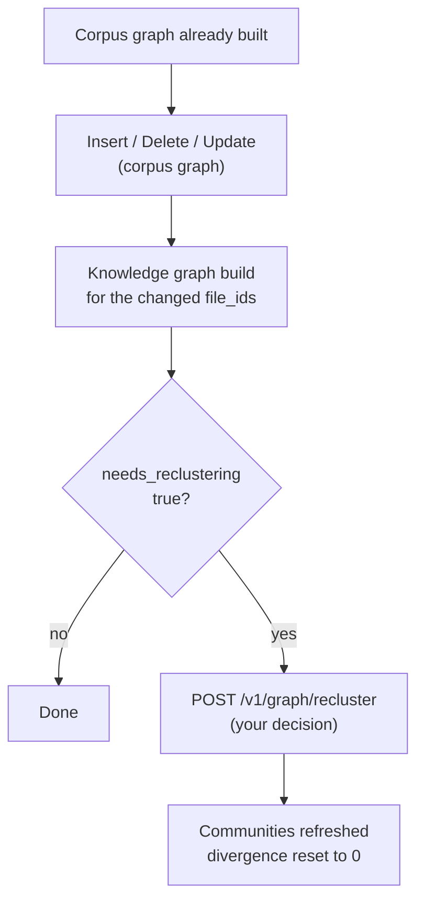



**Incremental Graph Updates (IGU)** let you add, remove, and replace documents
in a knowledge graph that is already built, in place and without rebuilding it
from scratch. Only the documents that changed are processed. Nothing is
re-imported: the [corpus build](../reference/corpus-build.md) and the
[RAG Strategizer](../reference/rag-strategizer.md) do not run again, and the
knowledge graph is only rebuilt for the changed documents, not for whole
partitions. This makes everyday document changes much cheaper and faster than a
rebuild.


**IGU is API-only in Arango Contextual Data Platform 4.1.0.** You can insert,
delete, update, and recluster documents through the
[HTTP endpoints](api-reference.md) only. In later releases, the
[web interface](../web-interface.md#update-documents-in-the-knowledge-graph)
offers these operations as well.


## Supported operations

An AutoGraph project holds two graphs, and IGU keeps both of them in sync:

- The **corpus graph** contains your documents, the similarity edges between
  them, and the clusters they are grouped into. Each cluster has a retrieval
  strategy assigned to it.
- The **knowledge graph** is built from the clusters. It contains the chunks,
  entities, relationships, and communities that were extracted from the
  documents.

Each operation changes these two graphs in its own way:

| Operation | What it does | Corpus graph | Knowledge graph |
|-----------|--------------|--------------|-----------------|
| [Insert](#insert) | Adds documents that are not in the graph yet | AutoGraph adds the documents to the closest existing cluster | Added afterwards, by a knowledge graph build that you start |
| [Delete](#delete) | Removes documents and all of their graph data | AutoGraph removes the documents | AutoGraph removes their data first, in the same call |
| [Update](#update) | Replaces the content of documents that already exist | AutoGraph removes the old version and adds the new one | AutoGraph removes the old data. The new version is added afterwards, by a knowledge graph build that you start |
| [Recluster](#partition-divergence-and-reclustering) | Regroups the entities of a FullGraphRAG partition that has drifted | Not touched | The Importer rebuilds the communities of the partition |

A [**knowledge graph build**](api-reference.md#build-the-knowledge-graph-for-changed-documents) extracts the entities and relationships of the new
content and adds them to the knowledge graph.

This page explains the concepts. For the endpoints, requests, and responses,
see the [API Reference](api-reference.md).

## How the operations work

Existing clusters and strategies are kept: a new document joins the cluster
closest to it, so the whole category does not have to be clustered again. See
[Architecture](../architecture.md) for the full data model.

### Insert

An insert adds documents that are not in the graph yet. AutoGraph stores the
source and its embedding, links it to its nearest neighbours with similarity
edges, and assigns it to the closest existing cluster. The new document
inherits that cluster's strategy profile, so the RAG Strategizer does not
run again. IGU cannot change the strategy of a cluster or add new
strategies.



You get a response as soon as the documents are in the corpus graph. They are
not in the knowledge graph yet: to add them, start a
[knowledge graph build](api-reference.md#build-the-knowledge-graph-for-changed-documents) with the
`file_id` values of the inserted documents.

### Delete

A delete removes documents together with all of their graph data. AutoGraph
cleans up the knowledge graph first, with AQL queries of its own, and then
removes the documents, similarity edges, and cluster membership from the corpus
graph. The
remaining documents are not touched.



The response is the final result, so there is nothing to wait for and no
knowledge graph build to run afterwards.

### Update

An update replaces the content of documents that are already in the graph. It
is a delete followed by an insert, which is why its knowledge graph work is split
between AutoGraph and the Importer in exactly that way:

1. AutoGraph removes the old knowledge graph data of the documents.
2. AutoGraph removes the old documents from the corpus graph.
3. AutoGraph inserts the new versions into the corpus graph, computes their
   similarity edges again, and assigns each one to the closest cluster.



The update runs in the background. The response only confirms that it has
started and gives you an `update_id`. Once the update is done, start a
[knowledge graph build](api-reference.md#build-the-knowledge-graph-for-changed-documents) so that the
knowledge graph contains the new versions.

### Insert or update?

| | Insert | Update |
|--|--------|--------|
| **Use if** | The document is **not** in the graph yet | The document **already exists** and you want to replace its content |
| **Effect** | Adds the source and its embedding, assigns the closest cluster, and updates the corpus graph | Deletes the old graph data, waits for the knowledge graph cleanup, and then adds the new version to the corpus graph |
| **Knowledge graph** | Start a knowledge graph build afterwards, so that the knowledge graph includes the new document | Start a knowledge graph build afterwards for the new version |
| **Wrong choice** | Using insert for a `doc_name` or `file_id` that already exists creates duplicates and conflicts | Using update for a document that is not in the graph fails the validation |


Insert is not a safe replacement for update. If you replace content with an
insert call, the previous version of the document stays in the graph.


## When to use IGU

Use IGU to add, remove, or replace documents in an existing category, as long as
the change is small compared to what the category already holds. A batch of
documents is fine. A large change drives up the
[divergence score](#partition-divergence-and-reclustering) and leads to a costly
reclustering.

In all other cases, use one of the following instead:

| Situation | Use instead |
|-----------|-------------|
| No corpus graph exists yet | The [standard workflow](../reference/_index.md#standard-workflow) |
| A new category | A [corpus build](../reference/corpus-build.md) with `incremental: false` |
| Many new documents for an existing category | An [incremental corpus build](../reference/corpus-build.md#incremental-builds) with `incremental: true` |
| A category has to be rebuilt, for example because of wrong embeddings or clusters | [Delete the category](../reference/project-operations.md#delete-category), then run a corpus build, the RAG Strategizer, and a knowledge graph build |
| Only vectors on an existing collection | [`POST /v1/embed-field-in-collection`](../reference/embeddings.md) |

## Prerequisites

- **Arango Contextual Data Platform 4.1.0**, where IGU is only available through
  the HTTP API.
- An AutoGraph project with a corpus graph that has already been built.
  Typically, the RAG Strategizer and the knowledge graph build have run as well.
- The project was built through the
  [File Manager](../../file-manager/api.md#upload-a-rag-input-file),
  so that every document in the project has a `file_id`.
- The documents you want to change belong to **existing** categories.

## Workflow






Use [insert](api-reference.md#insert-documents),
[delete](api-reference.md#delete-documents), or
[update](api-reference.md#update-documents).



After an insert or update, start a
[knowledge graph build](api-reference.md#build-the-knowledge-graph-for-changed-documents)
for the changed `file_id` values. A delete needs no build.



Read the score of the affected partitions, see
[Where to read the score](#where-to-read-the-score).



If a partition is flagged and you decide it is worth the cost, see
[Partition divergence and reclustering](#partition-divergence-and-reclustering).




## Partition divergence and reclustering

In a **FullGraphRAG** partition, the entities of the knowledge graph are grouped
into communities, and summaries are built from these groups. Inserts, deletes,
and updates change the entities, so the communities and their summaries
gradually drift out of date. **Reclustering** groups the entities again, by what
the data looks like now, not by what it looked like when the partition was first
built.



Reclustering is expensive, so it does not run on every change. Instead,
AutoGraph tracks a **divergence score** per partition: how much of the partition
has changed since it was last clustered. Once the score is above the threshold,
the partition is flagged with `needs_reclustering: true`. AutoGraph never
reclusters on its own. You decide whether to
[recluster](api-reference.md#trigger-reclustering) the flagged partition, see
[Where to read the score](#where-to-read-the-score).

VectorRAG partitions have no communities, so they are never flagged.

### How the score is calculated

The stored score is the higher one of two values:

```text
divergence_score = max(gross_churn_score, multi_batch_score)
needs_reclustering = (divergence_score > divergence_threshold)
```

The **`divergence_threshold`** is stored per partition on the `rags` profile and
is **`0.25`** (25%) in this release. It is **not configurable through the API**:
no request field sets it, so every partition falls through to the default. The
only way to change it is to edit the `rags` document in ArangoDB by hand. A score
that is equal to the threshold does not set the flag, only a higher score does.

**Gross churn score**

```text
gross_churn_score = cumulative_churn / baseline_entity_count
```

- **`baseline_entity_count`** is the number of distinct entity names at the time
  of the last successful clustering or reclustering. The first time the score is
  measured after a partition is built, the current count becomes the baseline
  and the score starts at `0`.
- **`cumulative_churn`** is the total number of entities that have been added
  **and** deleted by all inserts, deletes, and updates since that baseline. The
  churn is **gross, not net**. An update that removes 100 entities and adds 100
  new ones therefore adds about 200 to the total, not 0.

For example, with a baseline of `1000` entities, deleting `100` entities and
then adding `100` gives a `cumulative_churn` of `200` and thus a
`gross_churn_score` of `0.20`.

**Multi-batch score**

If a partition has taken several incremental imports without being
consolidated, the same entities can exist multiple times across the import
batches. AutoGraph groups the entities by `import_number`, uses the **largest**
batch as the baseline, and counts everything outside of it as changed:

```text
multi_batch_score = (total_entities - largest_batch) / total_entities
```

A partition with a single batch, or with no entities at all, scores `0` here.
Batch sizes of `[500, 300, 200]`, for example, give
`(1000 - 500) / 1000 = 0.50`.

**Combined example**

If the gross churn is `0.20` and the multi-batch value is `0.50`, then the
`divergence_score` is `0.50`. With the threshold of `0.25`,
`needs_reclustering` is set to `true`.

### Where the values are stored

The divergence values are stored in the partition's `rags` strategy profile:

| Field | Meaning |
|-------|---------|
| `divergence_score` | The current score, calculated as described above |
| `divergence_threshold` | The threshold for this partition. Always `0.25`, as no API sets it |
| `needs_reclustering` | `true` as soon as the score is above the threshold |
| `last_reclustered_at` | When the partition was last clustered or reclustered successfully, as epoch seconds. This is also when the current baseline was taken |

### Divergence lifecycle

| Event | Effect on the divergence values |
|-------|----------------------------|
| First measurement after a build | The current entity count becomes the baseline, the score is `0`, and the flag is `false` |
| Insert, delete, or update, once the knowledge graph reflects the change | The score is calculated again, and the flag is set if the score is above the threshold |
| Successful `POST /v1/graph/recluster` | The score is reset to `0`, the churn is cleared, a new baseline is taken, the flag is cleared, and `last_reclustered_at` is set |
| Failed, deferred, or incomplete reclustering | The score and the flag stay as they are, so that you can try again later. A partition that never got the write slot is left untouched in exactly the same way |

### Where to read the score

A score is only meaningful once the knowledge graph reflects the change, so **insert and
update do not report one at all**. Their responses are produced while the work is
still in the corpus graph, before a knowledge graph build has created the
entities the score would be measured against. Rather than return a value that is
wrong by construction, AutoGraph leaves the field off.

That leaves three places to read it:

| Where | What you get | Notes |
|-------|--------------|-------|
| [`GET /v1/orchestrate/{orchestration_id}`](../reference/orchestration.md#monitor-an-orchestration), per entry of `jobs` | The **authoritative** score for each partition the run touched | This is the value to act on after an insert or an update. Held in memory only: a new `POST /v1/orchestrate` evicts the previous run, and an unknown or evicted id returns `404` |
| [`POST /v1/graph/delete`](api-reference.md#delete-documents), per file in `results` | The score after the deletion | Stamped **only** if `overall_status` is `COMMITTED`. A deletion that ends in `ROLLED_BACK` or `FAILED` writes no score |
| The partition's `rags` strategy profile | The **durable** state, see [Where the values are stored](#where-the-values-are-stored) | Survives eviction. Read it here when the build status is gone |

A delete can report its score directly because it removes the knowledge graph data
itself, before it returns. There is no import to schedule afterwards, so nothing
is still pending when the score is taken.
