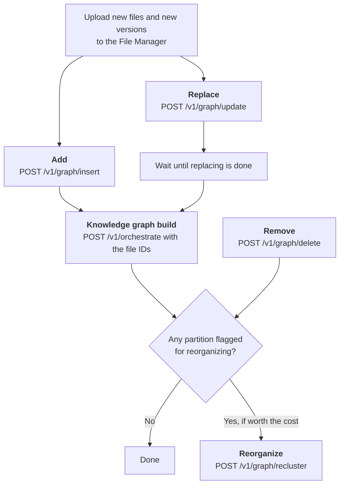



Add, replace, and remove documents in an existing category without rebuilding
the knowledge graph.

## Prerequisites

- **Arango Contextual Data Platform 4.1.x**.
- A built knowledge graph, with its files in the
  [File Manager](../../file-manager/api.md#upload-a-rag-input-file). The
  [AutoGraph Quick Start](../quick-start.md) builds one through the HTTP API.
- Documents in existing categories. For a new category, build the category
  instead, see [When to use IGU](_index.md#when-to-use-igu).
- Retrieval strategies for the category, from the
  [RAG Strategizer](../reference/rag-strategizer.md). Without them, added
  documents only reach the corpus graph. To find categories without strategies,
  check `strategies.categories_without_strategies` in the
  [Project Overview](../reference/project-operations.md#project-overview).

## How it works



## Example

This example changes the project `enterprise-docs-api` of the
[AutoGraph Quick Start](../quick-start.md), which has the 50 tech articles of
[tutorial 2](../../../get-started/contextual-data-platform/build-with-autograph.md)
in the category `tech_articles`. You add an article about Anthropic, replace
`openai.md` with a new version, and remove `motorola_mobility.md`. Then you
update the knowledge graph and check which parts of it need to be reorganized.

The example uses `curl` and [`jq`](https://jqlang.org/). Run all commands in
the same shell, from the directory that contains `./files/tech_articles`.
Responses are shortened where marked with `…`, and your IDs and numbers differ.
AutoGraph responses use camelCase.




Set the connection details and get a JWT session token:

```bash
ENDPOINT="https://<EXTERNAL_ENDPOINT>:8529"
DB="_system"
PROJECT="enterprise-docs-api"
CATEGORY="tech_articles"
TOKEN=$(curl -sk -X POST "$ENDPOINT/_open/auth" \
  -d '{"username": "root", "password": "<your-password>"}' | jq -r .jwt)
echo "$TOKEN" | cut -c1-20
```

If the output is `null`, the user name or password is wrong. If a later
request returns `Unauthorized`, the token has expired. Run this command again.
The `-k` option of `curl` accepts a self-signed certificate.



The path of the AutoGraph API contains the ID of the project's service. Read it
from the project metadata:

```bash
SERVICE_URL=$(curl -sk "$ENDPOINT/_platform/acp/v1/project_by_name/$DB/$PROJECT" \
  -H "Authorization: Bearer $TOKEN" \
  | jq -r .projectMetadata.autographService.serviceUrl)
AG="$ENDPOINT/autograph/$(basename "$SERVICE_URL")"
echo "$AG"
```

```text
https://<EXTERNAL_ENDPOINT>:8529/autograph/vyk1t
```



```bash
curl -sk "$AG/v1/projects/$PROJECT/overview" \
  -H "Authorization: Bearer $TOKEN" \
  | jq '{documents: .corpusGraph.documentCount,
         knowledge_graph: .knowledgeGraph.status,
         without_strategies: (.strategies.categoriesWithoutStrategies // [])}'
```

```json
{
  "documents": 50,
  "knowledge_graph": "built",
  "without_strategies": []
}
```

Continue if the knowledge graph is `built` and `tech_articles` is not in
`without_strategies`. Otherwise, finish the
[AutoGraph Quick Start](../quick-start.md) first.



Write a new article, and add a section to `openai.md` to make a new version of
it:

```bash
cat > ./files/tech_articles/anthropic.md <<'MD'
# Anthropic

Anthropic is an American artificial intelligence company founded in 2021 by
Dario Amodei, Daniela Amodei, and other former members of OpenAI. It develops
the Claude family of large language models. Amazon and Google are among its
largest investors, and Amazon Web Services is its primary cloud provider.
MD

cat >> ./files/tech_articles/openai.md <<'MD'

## Competition

Several former OpenAI employees founded Anthropic in 2021. Its Claude models
compete with ChatGPT.
MD
```

To run the example again, start from the original `openai.md`.



Upload both files to the File Manager, into the scope of the category, and keep
the `id` of each file:

```bash
for f in anthropic openai; do
  curl -sk -X POST "$ENDPOINT/_platform/filemanager/_db/$DB/rag-input" \
    -H "Authorization: Bearer $TOKEN" \
    -F "name=$f.md" \
    -F "scope=$PROJECT" \
    -F "scope=$CATEGORY" \
    -F "file=@./files/tech_articles/$f.md" \
    | jq '{id, name, version}' | tee "$f.json"
done
ANTHROPIC_ID=$(jq -r .id anthropic.json)
OPENAI_ID=$(jq -r .id openai.json)
```

```json
{
  "id": "rag-input-…",
  "name": "anthropic.md",
  "version": 1
}
{
  "id": "rag-input-…",
  "name": "openai.md",
  "version": 2
}
```

`openai.md` has `version` 2, because it has the same name and scope as the
file that is already in the category. It keeps the `id` of that file.



```bash
curl -sk -X POST "$AG/v1/graph/insert" \
  -H "Authorization: Bearer $TOKEN" \
  -H "Content-Type: application/json" \
  -d "{\"category\": \"$CATEGORY\",
       \"files\": [{\"doc_name\": \"anthropic.md\", \"file_id\": \"$ANTHROPIC_ID\"}]}" | jq
```

```json
{
  "results": [
    {
      "docName": "anthropic.md",
      "success": true,
      "ragPartitionId": "enterprise-docs-api_tech=uarticles_5_a",
      "clusterKey": "cluster_enterprise-docs-api_tech=uarticles_5",
      "fileId": "rag-input-…"
    }
  ]
}
```

Check that `success` is `true` and that `ragPartitionId` is set. Without a
partition, the knowledge graph build skips the article, see
[Add documents](api-reference.md#add-documents).



```bash
curl -sk -X POST "$AG/v1/graph/update" \
  -H "Authorization: Bearer $TOKEN" \
  -H "Content-Type: application/json" \
  -d "{\"category\": \"$CATEGORY\",
       \"files\": [{\"doc_name\": \"openai.md\", \"file_id\": \"$OPENAI_ID\"}]}" | jq
```

```json
{
  "updateId": "update_…",
  "accepted": true,
  "message": "Update started",
  "results": []
}
```

Replacing runs in the background. Its progress is in the
`importerOrchestration` entry of the project metadata, as a JSON string in
`message`. Wait until its `phase` is `DONE`:

```bash
until curl -sk "$ENDPOINT/_platform/acp/v1/project_by_name/$DB/$PROJECT" \
    -H "Authorization: Bearer $TOKEN" \
    | jq -e '.projectMetadata.autographService.importerOrchestration.message
             | (fromjson? // {}) | .phase == "DONE"' > /dev/null; do
  echo "replacing..."
  sleep 5
done
curl -sk "$ENDPOINT/_platform/acp/v1/project_by_name/$DB/$PROJECT" \
  -H "Authorization: Bearer $TOKEN" \
  | jq '.projectMetadata.autographService.importerOrchestration.message | fromjson'
```

```json
{
  "phase": "DONE",
  "status": "completed",
  "summary": "Updated 1 file(s) in Layers 1-2; run orchestrate to re-import Layer 3",
  "files": [
    {
      "file": "openai.md",
      "result": "updated",
      "cluster": "cluster_enterprise-docs-api_tech=uarticles_5",
      "previous_cluster": "cluster_enterprise-docs-api_tech=uarticles_10",
      "partition": "enterprise-docs-api_tech=uarticles_5_a",
      "file_id": "rag-input-…"
    }
  ]
}
```

Replacing is done when `status` is `completed` and the entry for `openai.md`
has `result: "updated"` and no `error`. In this run, the new version moved to
another cluster, see `previous_cluster`.


Wait for `phase: "DONE"`, not for `status: "completed"`. Right after you start
replacing, the entry still holds the message of the previous knowledge graph
build, such as `Orchestration completed: 11 succeeded, 0 failed`, with
`status: "completed"`.




```bash
curl -sk -X POST "$AG/v1/graph/delete" \
  -H "Authorization: Bearer $TOKEN" \
  -H "Content-Type: application/json" \
  -d "{\"category\": \"$CATEGORY\", \"doc_names\": [\"motorola_mobility.md\"]}" \
  | jq '{overallStatus,
         results: [.results[] | {ragPartitionId, status, divergenceScore, needsReclustering}]}'
```

```json
{
  "overallStatus": "DELETE_OVERALL_STATUS_COMMITTED",
  "results": [
    {
      "ragPartitionId": "enterprise-docs-api_tech=uarticles_4_a",
      "status": "LAYER2_DELETE_STATUS_SUCCESS",
      "divergenceScore": 0.41935483870967744,
      "needsReclustering": true
    }
  ]
}
```

Removing is done once `overallStatus` is `DELETE_OVERALL_STATUS_COMMITTED`.
It removes the entities of the article from the knowledge graph and deletes
`motorola_mobility.md`, with all its versions, from the File Manager.

Note `needsReclustering`. The knowledge graph build in the next step only
reports the partitions it builds, and the removed article was in another one.



Start a knowledge graph build for the added and the replaced article. Removed
articles need no build.

```bash
ORCH_ID=$(curl -sk -X POST "$AG/v1/orchestrate" \
  -H "Authorization: Bearer $TOKEN" \
  -H "Content-Type: application/json" \
  -d "{\"project\": \"$PROJECT\", \"replicas\": 1,
       \"file_ids\": [\"$ANTHROPIC_ID\", \"$OPENAI_ID\"]}" \
  | tee orchestrate.json | jq -r .orchestrationId)
jq '{orchestrationId, success, message, unmatchedFileIds}' orchestrate.json
```

```json
{
  "orchestrationId": "orch_…",
  "success": true,
  "message": "Orchestration started",
  "unmatchedFileIds": []
}
```

If `unmatchedFileIds` lists any IDs, the build skips those articles, see
[Add documents](api-reference.md#add-documents). Wait until the build is done:

```bash
while [ "$(curl -sk "$AG/v1/orchestrate/$ORCH_ID" \
  -H "Authorization: Bearer $TOKEN" | jq -r .status)" = "running" ]; do
  echo "still running"
  sleep 30
done
curl -sk "$AG/v1/orchestrate/$ORCH_ID" -H "Authorization: Bearer $TOKEN" \
  | jq '{status, message,
         jobs: [.jobs[] | {ragPartitionId, status, divergenceScore, needsReclustering}]}'
```

```json
{
  "status": "completed",
  "message": "Orchestration completed: 1 succeeded, 0 failed",
  "jobs": [
    {
      "ragPartitionId": "enterprise-docs-api_tech=uarticles_5_a",
      "status": "completed",
      "divergenceScore": 0.44177881802223523,
      "needsReclustering": true
    }
  ]
}
```

Only the partition that contains the two articles was processed.



Each response so far reported only some of the changed partitions. The
strategy profiles hold the current values of all of them:

```bash
curl -sk "$AG/v1/rag-strategizer/strategy" -H "Authorization: Bearer $TOKEN" \
  | jq '[.. | objects | select(has("parameters") and has("ragPartitionId"))
         | {ragPartitionId, divergence_score: .parameters.divergence_score,
            needs_reclustering: .parameters.needs_reclustering}
         | select(.divergence_score != "0")]'
```

```json
[
  {
    "ragPartitionId": "enterprise-docs-api_tech=uarticles_10_a",
    "divergence_score": "0.18080548414738645",
    "needs_reclustering": "false"
  },
  {
    "ragPartitionId": "enterprise-docs-api_tech=uarticles_4_a",
    "divergence_score": "0.41935483870967744",
    "needs_reclustering": "true"
  },
  {
    "ragPartitionId": "enterprise-docs-api_tech=uarticles_5_a",
    "divergence_score": "0.44177881802223523",
    "needs_reclustering": "true"
  }
]
```

Three partitions changed:

- Partition `…_5_a` received the new article and the new version of
  `openai.md`.
- Partition `…_4_a` lost `motorola_mobility.md`.
- Partition `…_10_a` lost the old version of `openai.md`, because the new
  version moved to another cluster. No earlier response reported this
  partition.

Two of them are above the threshold of 25%.



To rebuild the communities of the flagged partitions, pass their
`ragPartitionId` values:

```bash
curl -sk -X POST "$AG/v1/graph/recluster" \
  -H "Authorization: Bearer $TOKEN" \
  -H "Content-Type: application/json" \
  -d '{"partition_ids": ["enterprise-docs-api_tech=uarticles_4_a",
                         "enterprise-docs-api_tech=uarticles_5_a"]}' | jq
```

Reorganizing blocks every other change to the corpus while it runs. Before you
start it, see
[Divergence and Reorganization](divergence-and-reorganization.md).



