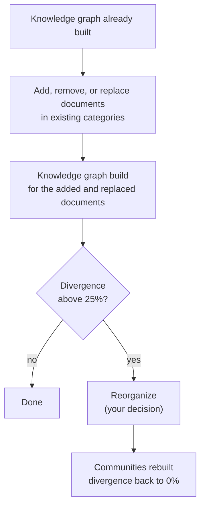



This guide shows you how to keep a knowledge graph up-to-date through the API:
you add, remove, and replace documents in its **existing categories**, add the
changes to the knowledge graph, and reorganize the knowledge graph once it has
changed a lot. For the concepts and terms, see
[Incremental Graph Updates](_index.md).

## Prerequisites

- **Arango Contextual Data Platform 4.1.0**, where Incremental Graph Updates are
  only available through the HTTP API.
- An AutoGraph project whose knowledge graph has already been built: the corpus
  build, the RAG Strategizer, and the knowledge graph build have run.
- The project was built from files in the
  [File Manager](../../file-manager/api.md#upload-a-rag-input-file), so that
  every document has a `file_id`.
- The documents you want to change are in **existing categories**. To add a new
  category, run the full build for it instead, see
  [When to use IGU](_index.md#when-to-use-igu).
- A **valid JWT** for the API. Every call uses an
  `Authorization: Bearer <token>` header.

## Update your knowledge graph






{{< endpoint "POST" "https://<EXTERNAL_ENDPOINT>:8529/_platform/filemanager/_db/{database}/rag-input" >}}
Upload the documents you want to add, and the new versions of the documents you
want to replace, to the [File Manager](../../file-manager/api.md#upload-a-rag-input-file)
under the scope of their **existing category**. Note the `file_id` of every
file.




Add documents that are not in the category yet:

```json
{
  "files": [{ "doc_name": "new-contract.pdf", "file_id": "<new-file-id>" }],
  "category": "legal"
}
```

The response lists the result of every document. See
[Add documents](api-reference.md#add-documents).




Replace documents that are **already in the category** with their new version:

```json
{
  "files": [{ "doc_name": "contract.pdf", "file_id": "<new-version-file-id>" }],
  "category": "legal"
}
```

Replacing runs in the background. Wait until it is done before you continue,
and check the result of every document. See
[Replace documents](api-reference.md#replace-documents).




Remove documents that are **in the category**:

```json
{
  "file_ids": ["<old-file-id>"],
  "category": "legal"
}
```

Removing also deletes the entities of the documents from the knowledge graph,
so you do not need a knowledge graph build afterwards. See
[Remove documents](api-reference.md#remove-documents).




Start a knowledge graph build for the documents you added or replaced:

```json
{
  "project": "my_project",
  "replicas": 1,
  "file_ids": ["<new-file-id>", "<new-version-file-id>"]
}
```

Then poll
[`GET /v1/orchestrate/{orchestration_id}`](../reference/orchestration.md#monitor-an-orchestration)
until `status` is `completed`. See
[Build the knowledge graph for changed documents](api-reference.md#build-the-knowledge-graph-for-changed-documents).



The build status reports `divergence_score` and `needs_reclustering` for every
partition it touched. A removal reports them in its response. If
`needs_reclustering` is `true`, the partition has changed a lot since it was
last organized. See
[Where to read the divergence](divergence-and-reorganization.md#where-to-read-the-divergence).




Reorganize the flagged partitions, at most five per request:

```json
{
  "partition_ids": ["legal_0_a"]
}
```

Reorganizing blocks all other changes to the project until it is done, which
can take up to an hour per partition, so run it in a maintenance window. See
[Reorganize partitions](api-reference.md#reorganize-partitions).




## Next steps

- [Divergence and Reorganization](divergence-and-reorganization.md): How the
  divergence is calculated and when to reorganize.
- [API Reference](api-reference.md): All requests, responses, and status codes.
