

Learn how to use AutoGraph Studio to build a Context Graph from your documents.
AutoGraph analyzes your content, builds a Corpus Graph, and generates the
strategies for a Knowledge Graph. AutoRAG then deploys the retrievers that
answer questions from that Context Graph.

The workflow has two stages:

1. **AutoGraph**: Builds your Context Graph. This can be your finish line.
2. **AutoRAG**: Deploys retrievers so your agents and applications can answer
   questions from that Context Graph.

## Open AutoGraph Studio

1. From the left-hand sidebar, select the database where you want to create the
   project. You can switch to a different database at any time if you want to
   work elsewhere.
2. In the left-hand sidebar, click **Agentic AI Suite**, then click
   **AutoGraph Studio**. You can also open the **Agentic AI Suite** overview and
   click **Run AutoGraph Studio**.

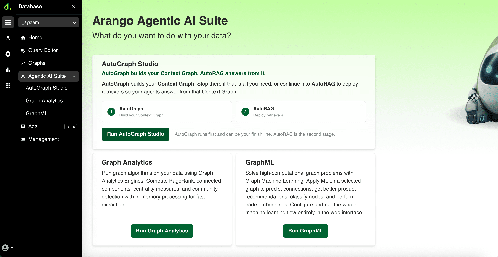


To keep a built knowledge graph up-to-date by adding, removing, or replacing
individual documents, see
[Update documents in the Knowledge Graph](#update-documents-in-the-knowledge-graph).
In Arango Contextual Data Platform 4.1.0, these operations are only available
through the [API](incremental-graph-updates/api-reference.md).


## Create an AutoGraph project

1. In the **AutoGraph Studio** view, click **+ New Project**. A database without
   any projects reports *No projects yet*.

   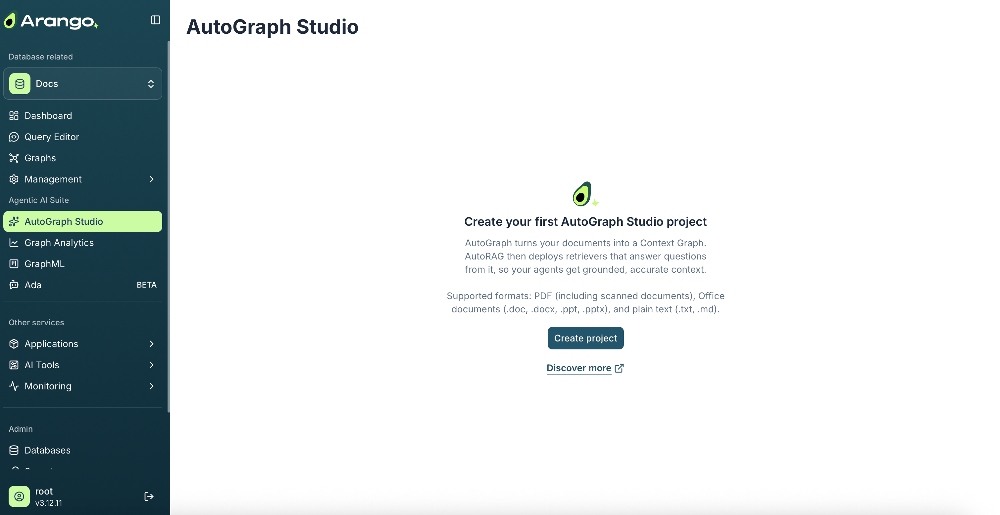

   Existing projects of the current database are listed in a table with their
   **Name**, **Description**, and **Actions**. Click a column header to sort, use
   **Filters** to narrow the list, and click a project name to open it.

   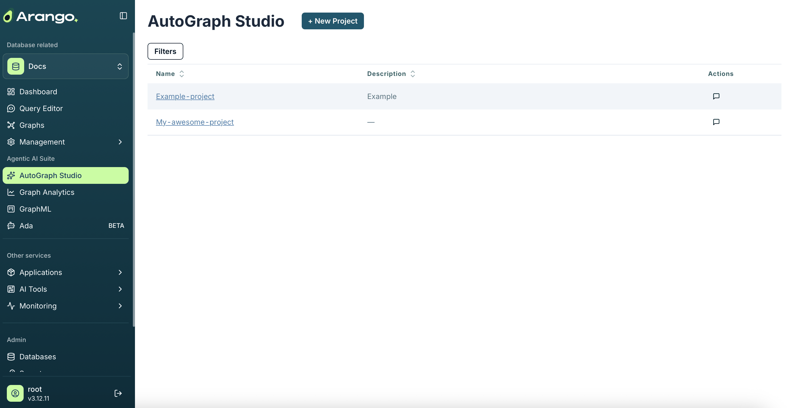

2. The **New project** dialog opens. Enter a **Project name** and, optionally,
   a **Description** of what this project's knowledge base is for.

   The project name must start with a letter and can only contain letters,
   numbers, underscores, and hyphens. Spaces are not allowed. It must be
   between 1 and 63 characters long.

   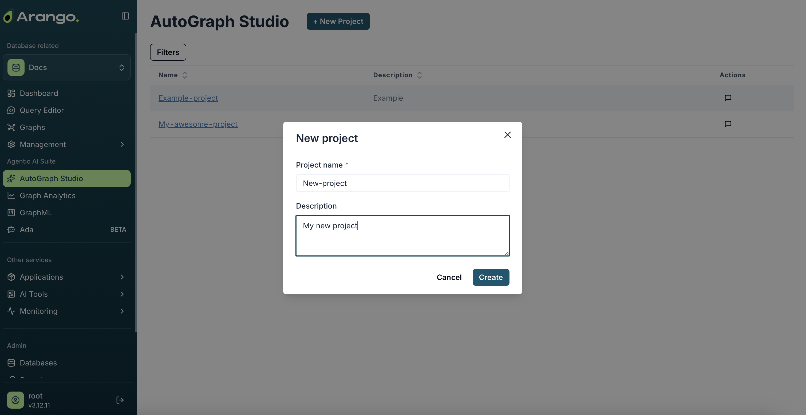

3. Click **Create**.

The project opens the three-step setup wizard: **Documents**, **Configure**,
and **Build**.

## Add your documents

In the **Documents** step, you upload documents into categories. Each upload
becomes a category that you name and can edit later. Documents are uploaded to
the project when you continue to the next step.

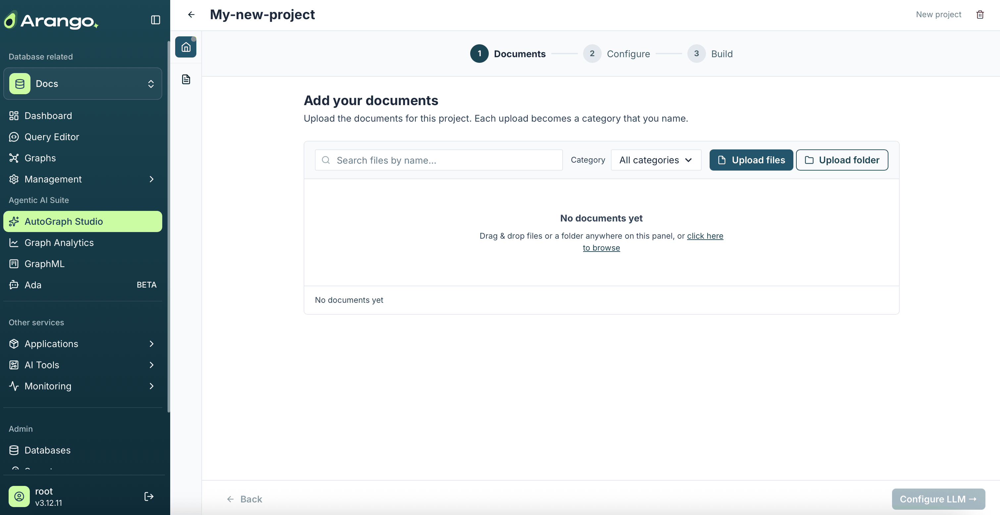

1. Click **Upload files** to select individual files, or **Upload folder** to
   upload an entire folder. You can also drag files or a folder anywhere onto the
   panel. Supported file formats are:
   - **Text files**: `.txt`, `.md`
   - **PDF files**: `.pdf`, including scanned documents
   - **Office documents**: `.docx`, `.pptx`, `.doc`, `.ppt`

   For details, especially around image extraction, see
   [Format support](document-conversion.md#format-support).
2. The **Name this category** dialog opens and lists the files you selected.
   Enter a short, unique **Category name** that describes what these files
   cover, for example `architecture` or `release-notes`. You can edit it later.

   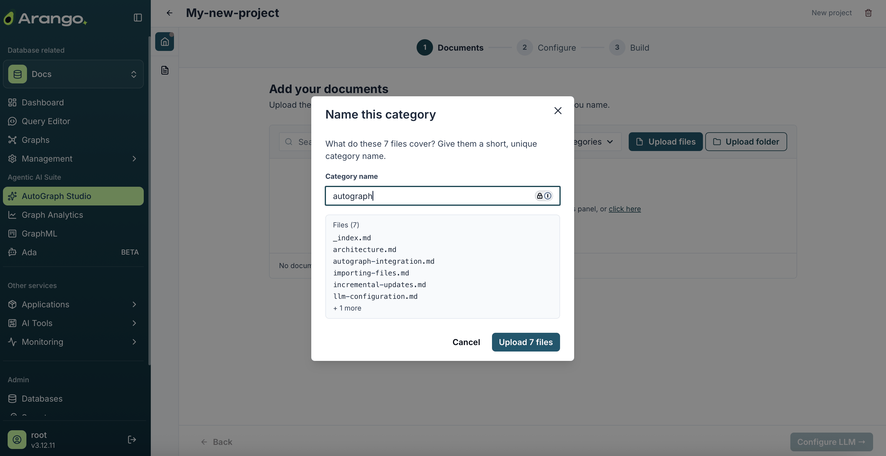

3. Click **Upload # files**.
4. The files appear grouped under the category with a **Pending** status and
   their file size.

   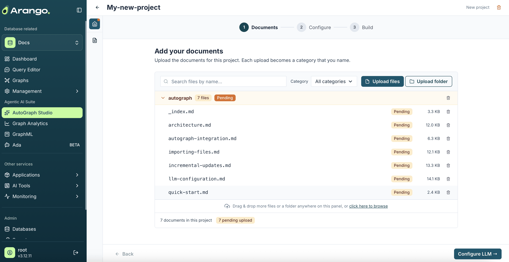

   You can:
   - Use the **Search files by name** field and the **Category** dropdown to
     filter the list.
   - Remove a single file with the cross icon, or delete a whole category with
     the trash icon.
   - Repeat the upload to add more categories. Every upload opens its own
     **Name this category** dialog, and the files you already staged stay pending
     in the background. The footer counts them across all categories, for example
     *17 pending upload*.

     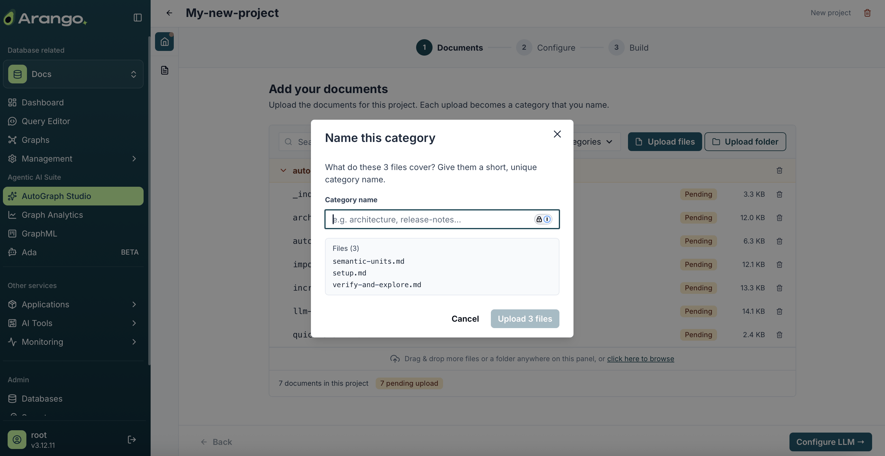

     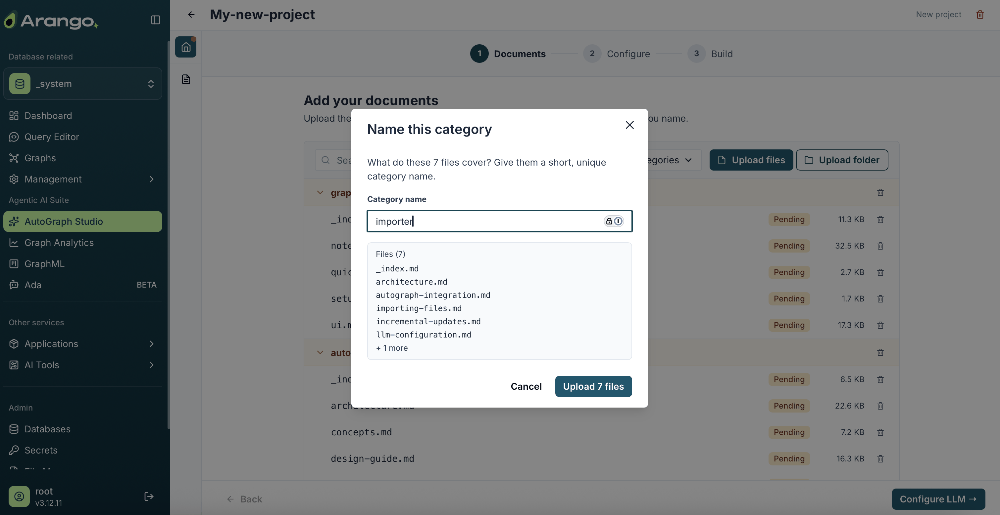

5. Click **Configure LLM**. The documents are uploaded to the project, with the
   progress reported as *Uploading `<N>` documents…*, and the wizard continues to
   the configuration step automatically.

   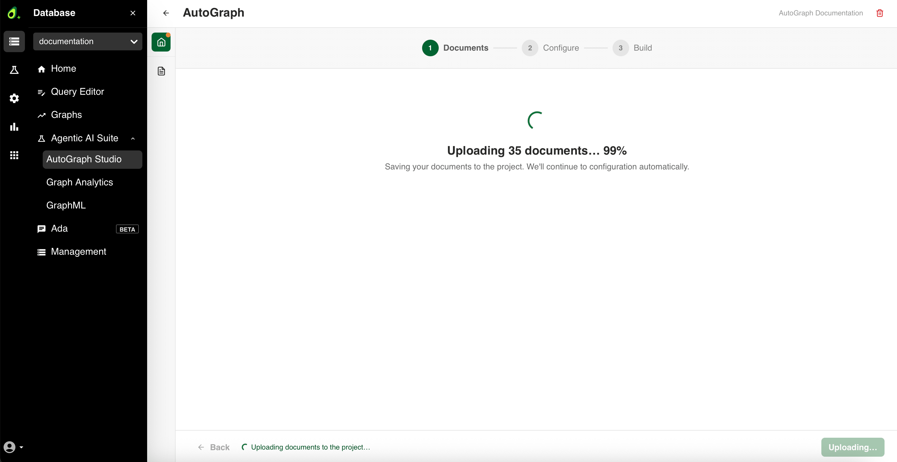

   The categories are listed with their file counts once the upload completes.

   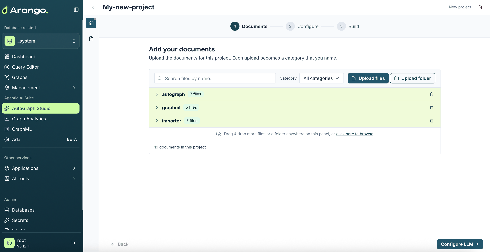


If you drop a folder, its name is used as the category name. For loose files,
you name the category yourself.


## Configure the LLM provider

In the **Configure** step, choose the LLM provider used to build the Corpus
Graph. A banner confirms what you are building from, for example
*Building from 35 documents across 3 categories*. A callout summarizes what
clicking **Start build** does: it deploys the AutoGraph service with these
settings and builds the Corpus Graph from your uploaded documents. When it is
ready, the wizard finishes at your project overview, where you can generate
retrieval strategies and build the Knowledge Graph (AutoRAG).

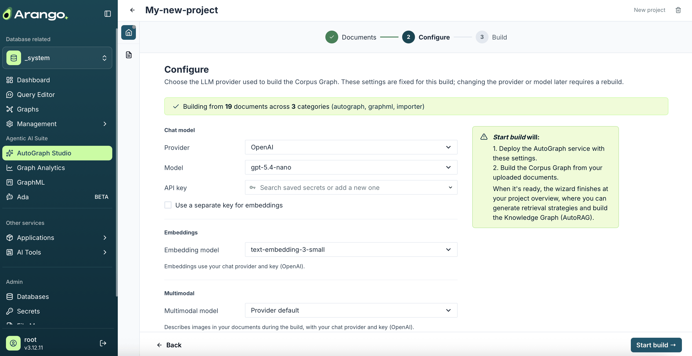


The Corpus Graph is built with the provider configuration you set here. You can
[change it later](#change-the-provider-or-key), but the change only applies to
future builds and queries — to re-process what you already built, rebuild the
Corpus Graph.





1. In the **Chat model** section, select **OpenAI** from the **Provider**
   dropdown menu.
2. Select the model you want to use from the **Model** dropdown menu.
   The default is `gpt-5.4-nano`.
3. In the **API key** field, search for a saved secret or add a new one. Keys are
   managed in the [Secrets Manager](../secrets-manager.md).
4. Optionally, select **Use a separate key for embeddings** to configure a
   separate provider and key for the embedding model. This adds a **Provider**
   dropdown menu and an **Embedding key** field to the **Embeddings** section.
   Otherwise, embeddings use your chat provider and key, as the hint below the
   **Embeddings** section states.
5. In the **Embeddings** section, select the **Embedding model**
   (`text-embedding-3-small` or `text-embedding-3-large`).
6. In the **Multimodal** section, select the **Multimodal model**. This model
   describes images in your documents during the build. Keep
   **Provider default** or select a specific model.
7. Click **Start build**.



1. In the **Chat model** section, select **Custom (OpenAI-compatible)** from the
   **Provider** dropdown menu.
2. Enter the URL of your OpenAI-compatible endpoint and the **Model** name.
3. In the **API key** field, search for a saved secret or add a new one. Keys are
   managed in the [Secrets Manager](../secrets-manager.md).
4. Optionally, select **Use a separate key for embeddings** to configure a
   separate endpoint and key for the embedding model.
5. Configure the **Embeddings** and **Multimodal** sections as needed.
6. Click **Start build**.





Every required key must be set before the build can start. The footer tells you
what is missing, for example *Enter the chat API key to continue*.


Clicking **Start build** moves the wizard to the **Build** step and deploys the
AutoGraph service with these settings. The Corpus Graph itself is built in the
next step, once the service is up and you click **Build Corpus Graph**.

For more details, see [LLM Configuration](llm-configuration.md).

## Build the Corpus Graph

The **Build** step shows the two operations it performs. For details on what
happens during the corpus build, see [Corpus Build](reference/corpus-build.md).

1. **Deploy AutoGraph service**: The service is deployed and the interface waits
   for it to respond, showing *Checking service status…* and
   *Service deployed — waiting for it to respond. This might take up to 10
   minutes.* The **AutoGraph service ID** is displayed, for example
   `arangodb-autograph-hiojb`.

   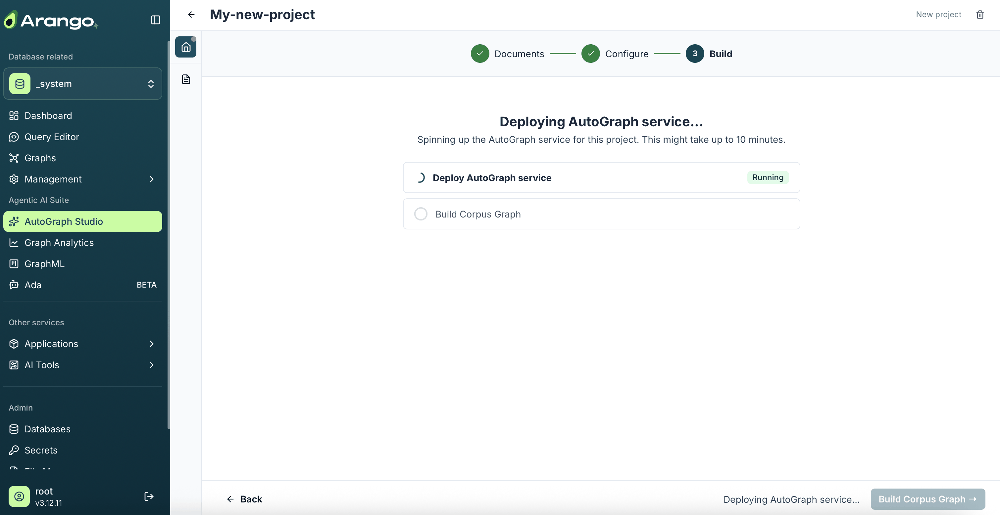

   Wait for the confirmation message **AutoGraph service deployed**.

   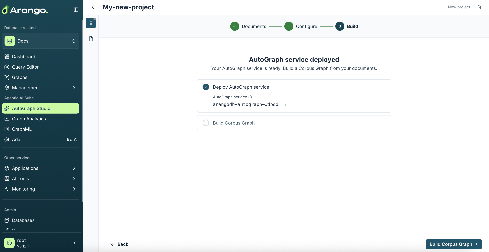

2. Click **Build Corpus Graph**.
3. **Build corpus**: Your documents are extracted into the Corpus Graph. The
   **Build Corpus Graph** step is marked as **Running** while it extracts your
   documents, which can take a while for large document sets.

   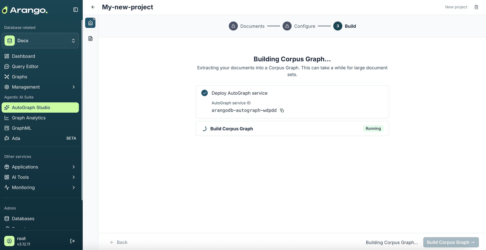

   When it completes, a **Corpus Graph ready** notification appears and the
   project overview opens.


If the build fails, the reason is shown above the step list, for example
*The LLM provider rejected the API key — update it in Configure*. Go **Back** to
fix the configuration, then click **Retry build**.


## The project overview

The project overview is the home of your project. It has the following sections:

- **Context Graph**: The Corpus Graph and the Knowledge Graph.
- **Categories**: The documents in the project, grouped by category.
- **Model & credentials**: The provider and models used by the build.
- **AutoRAG**: Deploy retrievers against your Context Graph.

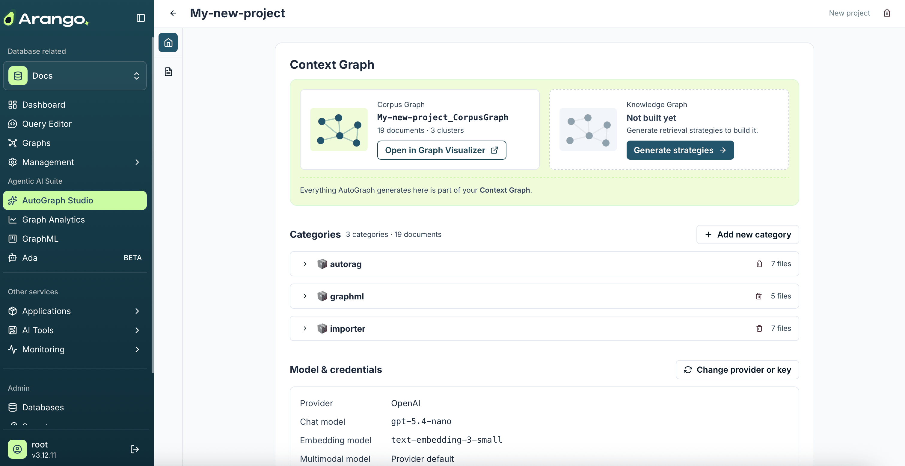

Your Context Graph is the Corpus Graph together with the Knowledge Graph — as
the **Context Graph** section puts it, everything AutoGraph generates there is
part of your Context Graph. The credentials and retriever services shown
alongside them configure and serve the Context Graph, but are not part of it.

## Explore the Corpus Graph

The **Corpus Graph** card shows the graph name (for example
`<project>_CorpusGraph`) and how many documents and clusters it holds.

Click **Open in Graph Visualizer** to inspect the graph. You can search and add
nodes to the canvas, run queries, change the layout, and style node types by
color, icon, and label, including attribute-based rules. For more information,
see [Graph Visualizer](../graph-visualizer.md).

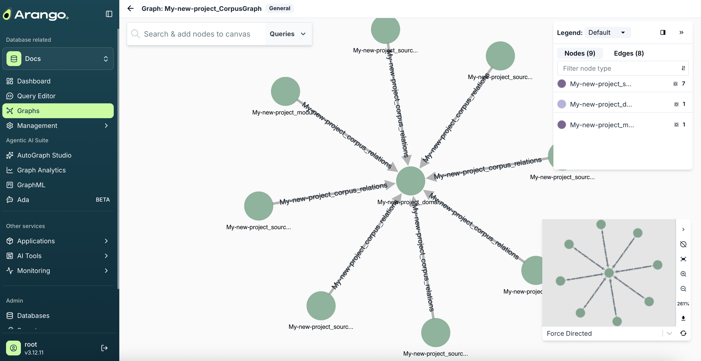

## Add more documents

You can add documents to an existing project at any time.

1. In the **Categories** section, click **+ Add new category**.
2. The **Add a new category** dialog opens. Drop files or a folder in the upload
   area, or use the **Choose files** and **Choose folder** buttons. Each upload
   becomes its own category, which you name next.
3. The staged categories are listed below the upload area. Use the pencil icon to
   rename a category, the trash icon to drop it, and the cross icon to remove a
   single file.
4. Click **Add `<N>` categories**.

Added categories are staged as pending. They are listed with a
**pending build** badge and an **Undo** button, and an
**Unbuilt changes — update the Corpus Graph** banner appears at the top of the
project naming the affected categories.

To include them in your Context Graph, click **Update Corpus Graph**. A
**Corpus Graph rebuilt** notification confirms that your category changes are
live. To drop the staged categories instead, click **Discard changes** in the
banner.


If the update fails, an error notification names the failing step, for example a
File Parser batch that produced no successful Markdown documents. Check the file
formats of the affected category and try again.


## Generate strategies and build the Knowledge Graph

The **Knowledge Graph** card shows the graph name (for example `<project>_kg`)
and whether the Knowledge Graph is built. Once it is, the card reports how many
entities and relationships it contains. The RAG Strategizer analyzes the
Corpus Graph and generates the import strategies per cluster. For details on how
strategies are determined, see [RAG Strategizer](reference/rag-strategizer.md).

Click **Generate strategies** on the **Knowledge Graph** card to open a
three-step wizard: **Configure**, **Review**, and **Build**.


**Generate strategies** is disabled while there are unbuilt changes. Update the
Corpus Graph first so that the strategies cover your latest documents.


### Configure strategy generation

**Complexity** sets the GraphRAG ↔ VectorRAG mix the strategizer applies across
your corpus. The strategizer partitions each category into clusters and assigns
every cluster the strategy that fits it. Drag the slider between
**Fast & cheap** and **Deep & thorough**:

| Level | Label | What it does |
|-------|-------|--------------|
| Fast & cheap | Vector only | Every cluster uses VectorRAG — chunks are embedded directly, no entity extraction. Cheapest and fastest to build. |
| Balanced | Balanced graph | The strategizer chooses GraphRAG or VectorRAG per cluster based on its content — a mix of both. |
| Thorough | Mostly graph | GraphRAG for most clusters — richer entity graphs and more relationships, at higher cost. |
| Deep | Graph + images | GraphRAG for every cluster, with image extraction always on. The most thorough and most expensive setting. |

Two intermediate stops between these levels let you fine-tune the mix.

**Extract images from documents** pulls entities and descriptions out of images
during the import, at extra cost. It needs a graph-heavy strategy: the checkbox
is disabled below **Thorough** and always on at **Deep**.

The **Estimated cost** card shows the relative cost of your selection, which
scales with how much you lean on GraphRAG and with image extraction.

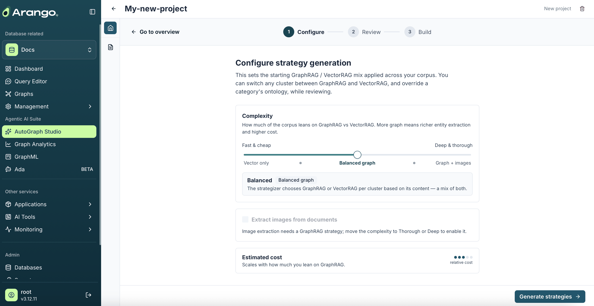

Click **Generate strategies**. Generation runs server-side, so you can leave the
page and come back. The wizard moves to **Review** and reports progress as
*Analyzing your corpus…*.

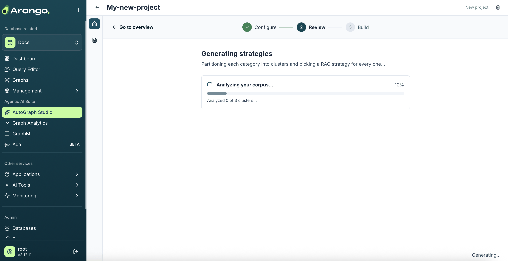

### Review strategies

The **Review strategies** step lists each category and the clusters below it,
with the assigned **Strategy**, the size of its **Ontology**, and the number of
**Documents**. Every category row summarizes its clusters, for example
*1 cluster · 1 GraphRAG · ontology: 12 types*. Your edits here are staged and
applied when you build — the footer counts them, for example
*1 staged edit — applied on build*, and edited rows are marked with an
**edited** badge.

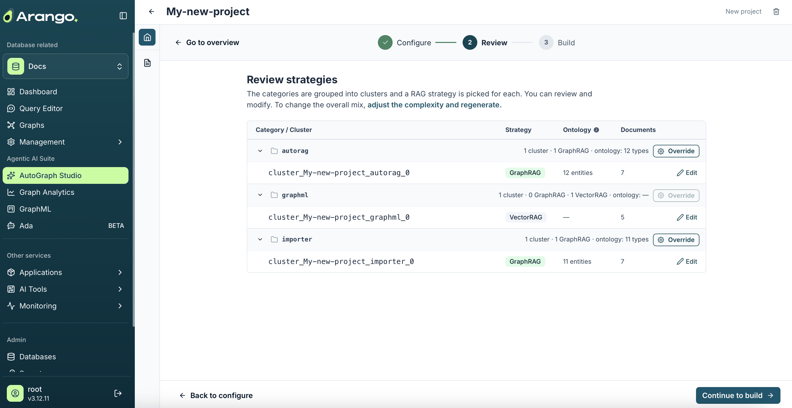

- Click **Edit** on a cluster to open its editor. You can switch the strategy
  **Type** between **GraphRAG** and **VectorRAG**, toggle
  **Extract images from documents** for GraphRAG clusters, and add, rename, or
  remove entity types under **Ontology — entity types**. Use **Prev** and
  **Next** to move between clusters.
- Click **Override** on a category to set one shared entity-type list for all of
  its GraphRAG clusters. The button is disabled while a category has no GraphRAG
  clusters — switch a cluster to GraphRAG first.
- To change the overall mix instead of individual clusters, click
  **adjust the complexity and regenerate**.


VectorRAG clusters have no ontology to customize and do not extract images.
Switch a cluster to **GraphRAG** to build entities and relationships from it.


Click **Continue to build** when you are happy with the strategies, or
**Back to configure** to change the complexity and regenerate.


If a GraphRAG cluster has no entity types, a dialog lists the affected clusters.
The build does not fail, but those clusters import with the generic fallback
ontology (`ORGANIZATION`, `PERSON`, `GEO`, `EVENT`) instead of entity types
tailored to your documents. Click **Cancel** to add entity types in the cluster
editor or via the category's **Override**, or **Build anyway** to continue.


### Build the Knowledge Graph

The **Build** step imports every cluster with its assigned strategy: GraphRAG
clusters extract entities and relationships, VectorRAG clusters embed chunks. It
names what it is about to build, for example
*Building 2 GraphRAG clusters and 1 VectorRAG cluster*. For details, see
[Orchestration](reference/orchestration.md).

Set **Parallel builds** to the number of clusters to import at the same time.
More parallel builds finish faster but put more load on the service. The default
is `1`.

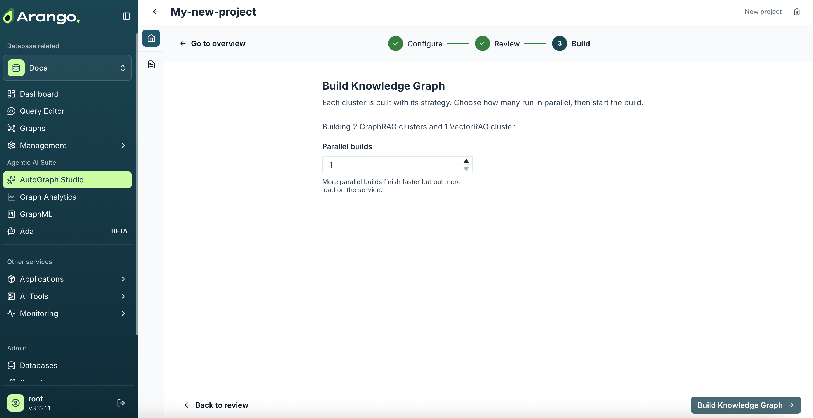

Click **Build Knowledge Graph** to start the import. It reports progress as
*Importing your corpus…* and runs server-side, so you can leave the page and
come back.

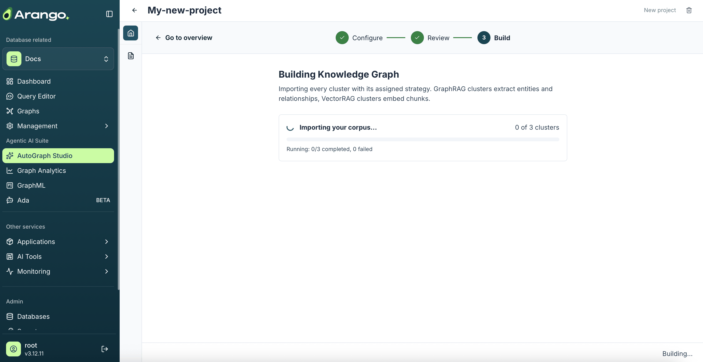

When the import finishes, **Knowledge Graph built** is displayed. Click
**Go to overview** to return to the project, where the **Knowledge Graph** card
now shows the graph as built.


You can explore the Knowledge Graph in the
[Graph Visualizer](../graph-visualizer.md) at any time.


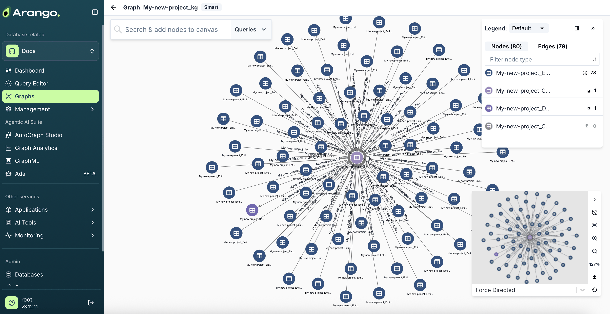

## Update documents in the Knowledge Graph

Once the Knowledge Graph is built, you can add, replace, and remove documents in
its categories without rebuilding it. Only the files that changed are processed:
AutoGraph adds them to the closest existing cluster, and their entities and
relationships are added to the Knowledge Graph. For what happens behind the
scenes, see [Incremental Graph Updates](incremental-graph-updates/_index.md).


Updating documents in the web interface is not available in Arango Contextual
Data Platform 4.1.0. In this release, use the
[Incremental Graph Updates API](incremental-graph-updates/api-reference.md).


### Add or replace files

In the **Categories** section, click **+ Add files** next to the category you
want to change, or drop files or a folder onto the category.

- **One or two files** start updating right away, as long as there is nothing to
  decide: each file is either new to the category or a new version of a file with
  the same name. The file is marked **Updating** in its row.
- **More than two files or a folder** open the **Add files to `<category>`**
  dialog first, so that you can review what is going to change.

In the **Add files** dialog, drop more files or a folder in the upload area, or
click **Choose files**. Every file is listed with a tag that says what happens
to it:

- **New**: The category has no file with this name. The file is added.
- **New version**: The category already has a file with this name. Its content
  is replaced with the new version.
- **Replaces `<file>`?**: The file name matches an existing file apart from a
  number or year, for example `report-2026.md` and `report-2027.md`. The new file
  is suggested as the successor of the old one, which is then removed. As this
  is only a guess, the tag ends with a question mark. Click its cross icon to
  add the file as **New** instead and keep the old one.
- **Unchanged, skipped**: The file is identical to the version already in the
  category, so it is not uploaded or processed again.
- **Not in folder**: When you drop a folder, files of the category that are
  missing from the folder are listed struck through. They are removed from the
  Knowledge Graph and deleted from the File Manager. Click the cross icon to keep
  such a file.

Click the cross icon at the end of a row to leave a file out of the update. If
every file is unchanged, the dialog reports that there is nothing to update.

Nothing is uploaded and the graph is not touched while the dialog is open.
Click **Update `<N>` files** to upload the files and start the update.

### Remove a file

1. In the **Categories** section, click the cross icon next to the file.
2. Confirm with **Remove file**. The knowledge extracted from the file is removed
   from the graph, and the file is deleted from the File Manager.

If an update is running, the removal waits until it has finished.

### Follow an update

While an update runs, a progress alert at the top of the project overview reports
it, for example *Updating knowledge graph (1 of 3 files)*. It lists every file
with what is being done to it, such as *Adding*, *Replacing*, or *Replaced*. The
update runs server-side, so you can leave the page and come back.

The project stays usable while the update runs. You can keep adding, replacing,
and removing files in any category. These changes are marked with a
**waiting for the current update** badge and an **Undo** button on their
category, are listed in the progress alert, and start by themselves once the
running update is done. To drop a waiting change before it starts, click the
cross icon on its row in the progress alert, or click **Undo** on the category.

To stop the update, click **Stop update** and confirm. The update stops after the
file that is currently being processed. Files that are already processed stay in
the graph, and the files that were still waiting are not processed, so you can
add them again later. Stopping does not undo the files that are done. To revert
them, remove them from the category.

### Review the result

When the update has finished, the alert summarizes what changed, for example
*md: 1 added, 2 replaced. 214 entities added.*

If a file could not be processed, the update still finishes for all the other
files. The alert lists the file that failed together with the reason, for
example *the file could not be read*. Click **Retry**, for example
**Retry 1 file**, to process only the failed files again.

Click **Show changes** to open the **Changes to this knowledge graph** dialog. It
lists every update of the project, newest first, with the category, what was
added, replaced, removed, or not added, the number of entities added, and the
time. Updates with failed files are highlighted. Open an update to see each file
and to retry the ones that failed.

### Reorganize the Knowledge Graph

Every update changes the entities of the Knowledge Graph, but not the
communities they are grouped into. Once a category has changed a lot since it
was last built or reorganized, the **Reorganize** button on the
**Knowledge Graph** card becomes available. For how this is measured, see
[Partition divergence and reclustering](incremental-graph-updates/_index.md#partition-divergence-and-reclustering).

1. Click **Reorganize**.
2. The **Reorganize knowledge graph** dialog lists the affected **Categories**,
   the expected **Time**, for example *Up to about 1 hour*, and the **Cost**.
   Reorganizing uses your model provider credits.
3. Click **Reorganize**.

File changes you make while the Knowledge Graph is being reorganized wait until
it finishes. If an update is running, **Reorganize** is only available after it
has finished.

## Change the provider or key

The **Model & credentials** card lists the **Provider**, **Chat model**,
**Embedding model**, and **Multimodal model** of your project.

1. In the **Model & credentials** section of the project overview, click
   **Change provider or key**.
2. In the dialog, select a different chat **Provider** or **Model**, or pick
   another saved **API key** to rotate the key in use. Keys are managed in the
   [Secrets Manager](../secrets-manager.md).
3. Confirm the change.

Changes apply to the running service right away and only affect future builds
and queries, as the dialog states. Your existing Corpus Graph and Knowledge Graph
are kept as they were built.

## Deploy an AutoRAG retriever

Retrievers let your agents and applications ask questions against your Context
Graph. You can deploy one or as many as you wish.


AutoRAG is the second stage — there is nothing to query until your Context Graph
is ready. **Deploy a retriever** stays disabled until the Knowledge Graph is
built, and the **Retrievers** panel points you back to the overview to build it.


1. Open the **Retrievers** panel from the document icon in the project sidebar,
   or click **Deploy a retriever** in the **AutoRAG** section of the project
   overview.
2. In the **Retriever services** list, click **+ Deploy**. Until you deploy one,
   the panel reports *No retriever services yet* and offers a
   **Deploy retriever** button as well.

   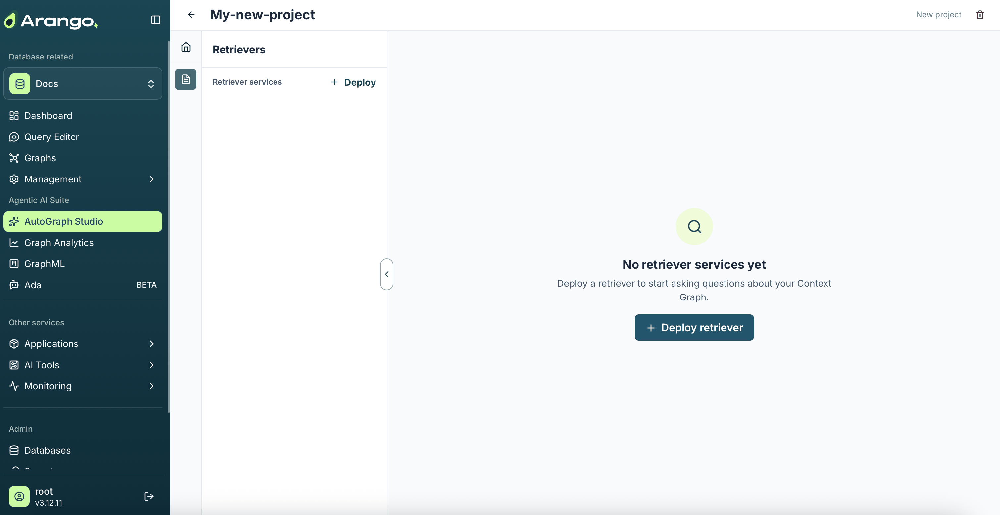

3. In the **Deploy retriever** form, configure the following:
   - **CHAT LLM**: The **Provider** (for example **OpenAI**), the
     **Chat model** (for example **GPT-5.4 Nano**), and the **Chat API key**.
   - **EMBEDDING**: The **Provider** and **Embedding model** — and the **URL**
     for a custom provider — are locked to your corpus build, because the
     retriever must embed queries with the same provider and model that the
     import used. The **Embedding API key** stays editable — the corpus pins the
     endpoint, not the credential for it, as the hint states:
     *Only its key can be changed*.
   - Both key fields are required and independent of each other. Select a saved
     key or add a new one for each. Keys are managed in the
     [Secrets Manager](../secrets-manager.md).

   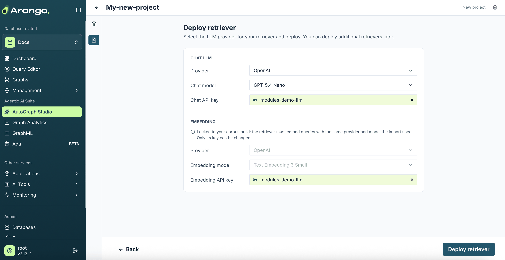

4. Click **Deploy retriever**.

The retriever appears in the **Retriever services** list. Retrievers have no name
of their own, so each is listed by its service ID with the
`graphrag-retriever-` prefix stripped, next to a colored status dot. Hover over
the dot for the status:

| Dot | Status | Meaning |
|-----|--------|---------|
| Green | Live | Ready to answer. |
| Yellow | Deploying | Starting up. This usually takes about a minute. |
| Red | Failed to start | Deployed, but not answering its health check. |
| Red | Failed to deploy | The service never came up. |

Select the retriever to see its full service ID and an **initializing** to
**live** status in the playground header.

## Ask questions against your Context Graph

Select a retriever from the list to open its question composer and its past
questions, then click **New question**. A retriever that has not answered
anything yet is listed as *No runs yet*. Past questions are marked with the mode
they ran in.


Until the service is ready to answer, a panel takes the place of the composer:
*Your retriever is starting up — wait 1 min until the retriever is started.* If
the service does not come up, the panel reports *This retriever isn't responding*
with a **Check again** button, or *This retriever failed to start*.


1. Choose a [search mode](../autorag/search-methods/_index.md):
   - **Instant**: Single-pass retrieval that combines semantic and lexical search
     with graph expansion. Lower latency, narrower coverage.
   - **Deep Search**: Multi-hop, LLM-planned retrieval. Higher latency, broader
     coverage.
2. Optionally, use the buttons next to the mode chips to shape the request.
   Active toggles show a cross that clears them again. For the underlying
   settings, see the [retriever parameters](../autorag/parameters.md).
   - **Add to query** (`+`): Attach extra context to the question you are asking.
     Once you change any option, the menu also offers **Reset to defaults**.
   - **Include metadata** (document icon): Return the retrieval metadata
     alongside the answer.
   - **Show citations** (book icon): Include inline citations in the answer.
     Citations are built from the retrieval metadata, so this toggle is disabled
     while **Include metadata** is off, and turning **Include metadata** off
     clears it.
   - **Use cache**: Answer from the retriever's cache when a similar question has
     been asked before, and store this answer for later questions. This saves an
     LLM round trip on repeated questions, but a cached answer reflects your
     Context Graph as it was when the answer was first generated. It is off by
     default.
   - **Response instruction**: Tell the model how to shape the answer, for
     example `Concise answer in 2-3 sentences` or
     `Provide detailed analysis with examples`. Without one, the default
     instruction for the search mode applies — Instant Search, for instance, aims
     for 60 words.
3. Select the chat model for the answer from the model dropdown menu, for example
   **GPT-5.4 Nano**.
4. Enter your question in the **Ask anything about your Context Graph** field and
   submit it, or click one of the **Suggested questions**.

Every claim in the answer links back to the exact source chunk it came from.

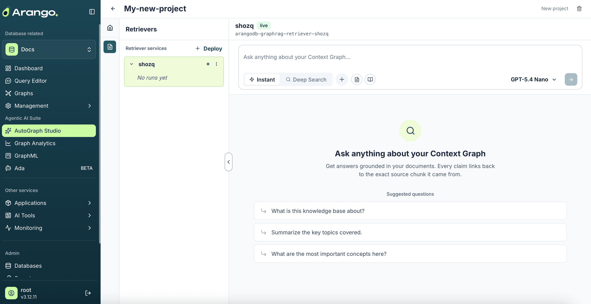

### See where an answer came from

Next to the answer itself, the **Provenance** tab shows the evidence the
retriever used to produce it, so you can verify a claim instead of taking it on
trust. It has the following views:

- **Citations**: The source passages the answer is built from, numbered to match
  the inline `[1]`, `[2]` markers in the text, for both search modes. Each entry
  names the document the passage comes from and shows the retrieved chunk itself,
  so you can compare a claim against the original wording. Documents imported
  with a canonical URL link out to it — see
  [`citable_url`](importer/parameters.md#file-source-parameters).
  Each entry also offers **Open document in database**.

  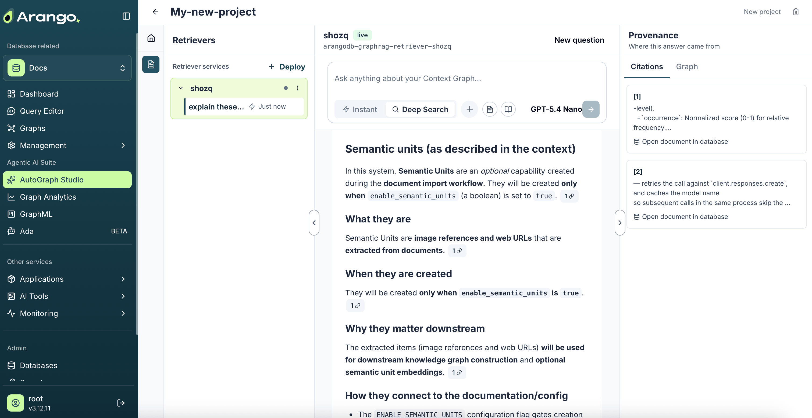

- **Graph**: The part of your Context Graph the answer was drawn from — the
  entities and relationships the retriever traversed to assemble it. This is
  where a GraphRAG answer differs from a plain vector search: you see the
  connections that produced the answer, not just the matching text. The view
  counts what it holds, for example *157 entities* and *265 relationships*.

  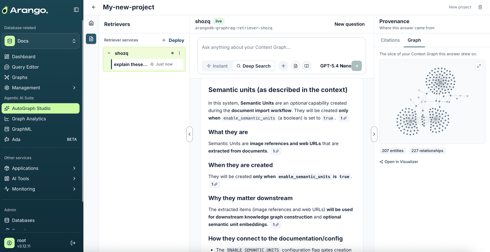

  Use the expand icon to open the slice as a **Context Graph slice** dialog, or
  **Open in Visualizer** to explore it in the
  [Graph Visualizer](../graph-visualizer.md).

  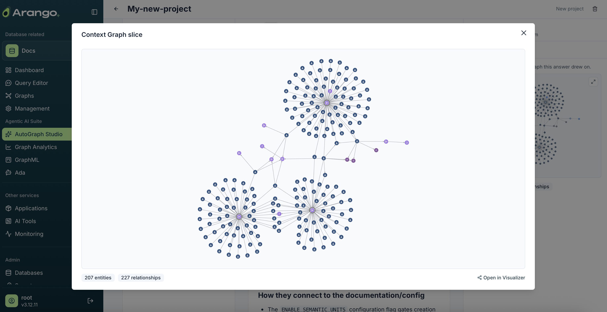

- **Trace**: Only shown for **Deep Search** answers. Deep Search splits your
  question into sub-questions and runs each step with the tool it selected for
  it, and the trace reports that work. Its header counts the steps and the tools
  involved, including the ones that failed, for example
  *5 steps · 4 of 6 tools used · 1 failed*. Tools come from the `Tools` collection
  and are defined manually; see
  [Tool configuration](../autorag/search-methods/custom-retriever.md#tool-configuration).

Each view needs the data it displays, so the tabs are only there if the answer
carries it: **Graph** and **Trace** require **Include metadata**, and
**Citations** requires **Include metadata** together with **Show citations**.
Both toggles are on by default. If you turn them off, the tabs disappear and the
panel names the toggle to switch back on instead.


Provenance is per question. Open a past question from the list to review the
citations and graph context of the answer it produced at the time.


## Manage retriever services

The **Retriever services** section of the **Retrievers** panel lists all
deployed retrievers with their status and past questions.

- Click **+ Deploy** to add another retriever with a different configuration.
- Use the menu next to a retriever for **Edit retriever** and
  **Delete retriever**. Both are only available while the service is live — a
  tooltip explains why they are disabled otherwise.
- Use the chevron between the list and the composer to collapse the list.

**Edit retriever** reopens the deploy form in edit mode, to update this
retriever's chat model, provider, or keys. Click **Save changes** to apply them
to the running service — no redeployment is needed.

Each retriever can have different settings for search mode, response
instructions, and other parameters, allowing you to create specialized
retrievers optimized for different types of queries or use cases. For more
details, see the [AutoRAG](../autorag/) reference documentation.
