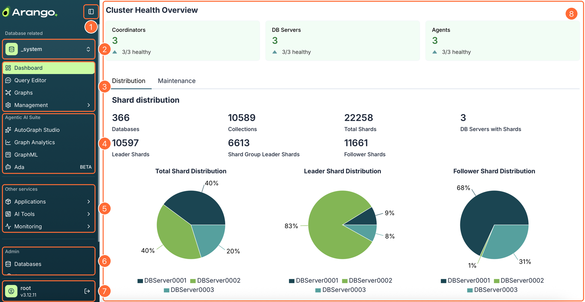
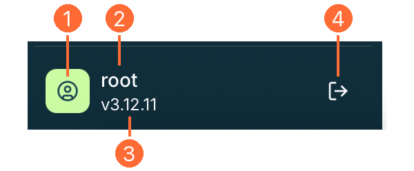

The Arango Contextual Data Platform comes with a unified web interface that
brings the ArangoDB core database system and the services of the data platform
together in a single place, including the AI services if your deployment has the
[Agentic AI Suite](../features-and-licensing.md#whats-included-in-the-agentic-ai-suite).
Every feature uses the same layout and the same controls, so once you know your
way around one part of the interface, you know your way around all of it.

To open the web interface, append `/ui/` to the base URL of your deployment,
for example, `https://<EXTERNAL_ENDPOINT>:8529/ui/`, and
[log in](../access-control/authentication.md#log-in-to-the-web-interface) with
an ArangoDB user account.

## The workspace at a glance

1. **Sidebar toggle**: Collapse the sidebar to get more room for your work, and
   expand it again.
2. **Database selector**: The database you are currently working in. Switch to
   another database at any time.
3. **Database tools**: Work with the data of the selected database, using the
   **Dashboard**, **Query Editor**, **Graphs**, and **Management** views.
4. **Agentic AI Suite**: Build Context Graphs with **AutoGraph Studio**, run
   **Graph Analytics** and **GraphML** jobs, and talk to your data with **Ada**.
5. **Other services**: Open deployed **Applications**, **AI Tools** such as
   notebook servers and MLflow, and the **Monitoring** dashboards.
6. **Admin**: Manage **Databases**, **Secrets**, the **File Manager**, and the
   **Container Manager**.
7. **Sidebar footer**: The user you are logged in as, the ArangoDB version, and
   the logout button.
8. **Workspace**: The main area where the selected view opens.

For a description of every sidebar entry, with the icon it uses and where to
find its documentation, see the [Sidebar reference](navigation.md).

## Sidebar

The sidebar on the left-hand side is how you move between the features of the
data platform. Its entries are grouped into sections, and each section has a
heading so you can tell at a glance which part of the platform an entry
belongs to.

- The entry of the view you are looking at is highlighted.
- An entry with a chevron () has sub-entries. For
  **Applications**, **AI Tools**, and **Monitoring**, the sub-entries open
  inside the sidebar. **Management** opens a second panel next to the sidebar
  instead, see [Management menu](navigation.md#management-menu).
- A **BETA** label next to an entry marks a feature that is still in beta and
  may change before it becomes generally available.
- If the sidebar is taller than your browser window, scroll it to reach the
  sections further down, such as **Admin**.
- Click the icon next to the Arango logo ()
  to collapse or expand the sidebar.

The entries you see can differ depending on the components installed in your
deployment.
For example, the **Agentic AI Suite** section is only available if your
data platform is licensed with the Agentic AI Suite, see
[Features and licensing](../features-and-licensing.md).

## Database selector

Most of what you do in the web interface happens in the context of a single
database. The database selector under the **Database related** heading shows
the database you are working in, for example, `_system`.

To switch to another database, click the selector, which shows the name of the
current database followed by an up-and-down arrow icon
(), and choose a database from the
list. Only the databases your user account has
access to are listed. The views below the selector, such as the
**Query Editor** and **Graphs**, then show the data of the newly selected
database.

To create or delete databases, go to **Admin** > **Databases**.

## Sidebar footer

The footer at the bottom of the sidebar shows who you are logged in as and which
version of ArangoDB you are connected to.

1. **Avatar**: Represents your user account.
2. **Username**: The ArangoDB user account you logged in with, for example,
   `root`. What you can see and do in the web interface is limited by the
   [permissions](../access-control/authorization.md) of this account.
3. **Version number**: The version of the **ArangoDB** core database system,
   for example, `v3.12.11`.
4. **Log out**: The icon on the right-hand side of the footer
   (). Ends your session and takes you back
   to the login screen.


The version number in the sidebar footer is the version of the ArangoDB
database system that the data platform runs on, **not** the version of the
Contextual Data Platform itself. The data platform and ArangoDB are versioned
independently. The web interface doesn't show the data platform version.
To learn which services and versions a data platform release includes, see
[Service versions](../release-notes/service-versions.md).


## Workspace

When you select an entry in the sidebar, its view opens in the workspace to the
right of the sidebar. Views follow a common structure:

- A **page title** at the top, sometimes preceded by a breadcrumb trail that
  shows where you are, such as **Agentic AI Suite** / **Graph Analytics**.
- A **primary action** button next to the title, such as **Add graph** or
  **New Project**, to create something new.
- **Tabs** to switch between the parts of a view, such as **Distribution** and
  **Maintenance** on the **Dashboard**.
- The **content** of the view, often a list of items you can open, filter, and
  act on.
