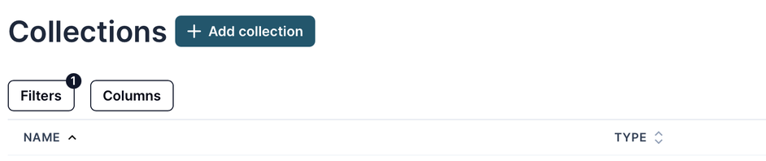
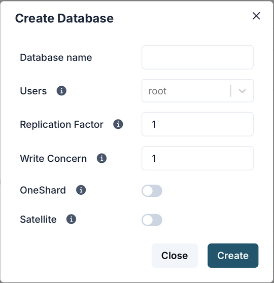
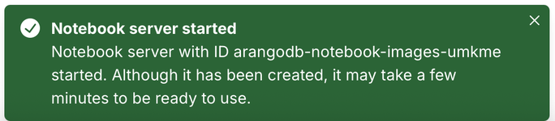
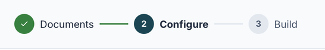
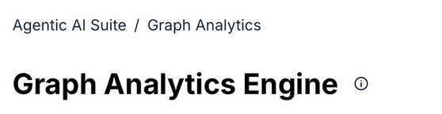

The views of the [data platform web interface](_index.md) are built from the
same set of controls. This page explains how they work so that you can apply
the same steps everywhere.

## Lists

Many views show a list of items, such as collections, graphs, users, or
AutoGraph projects.

- **Add**: The button next to the page title, such as **Add collection**,
  creates a new item. It usually opens a [dialog](#dialogs).
- **Filters**: Narrow the list down. Click **Filters**, then **Add filter**,
  and choose an attribute and a value. A number on the button shows how many
  filters are active. Click **Clear** to remove all filters.
- **Columns**: Choose which columns the list shows.
- **Sorting**: Click a column heading to sort the list by that column. Click it
  again to reverse the order. An arrow next to the heading shows the current
  sort order.
- **Opening an item**: Click the underlined name of an item to open it.
- **Row actions**: Icons in the **Actions** column act on a single item, for
  example,  to edit it or  to
  delete it.
- **Pages**: Long lists are split into pages. Use the page numbers below the
  list to move between them.

## Dialogs

Creating or editing an item opens a dialog on top of the current view.

- Fields marked with an asterisk (`*`) are required. The button that confirms
  the dialog, such as **Create**, stays disabled until all required fields
  are filled in.
- Hover over an info icon (ⓘ) next to a field to learn what it does.
- Toggles turn an option on or off.
- Sections such as **Advanced** are collapsed by default. Click a section to
  expand it and see more options.
- Some dialogs offer tabs for different variants of an item, for example,
  **GeneralGraph**, **SmartGraph**, and **SatelliteGraph** when you add a
  graph, or a **Show JSON** option to see the item definition as JSON.
- Click **Cancel**, **Close**, or the close icon () to
  dismiss the dialog without saving.

## Notifications

When an action completes in the background, a notification appears in the
bottom-right corner of the window. It tells you whether the action succeeded
and what happens next.

To dismiss a notification, click its close icon ().

## Wizards

Tasks with several steps, such as setting up an AutoGraph project, guide you
through a wizard. A step indicator at the top shows your progress.

- A checkmark marks a completed step.
- The current step is shown in bold with a filled number.
- Upcoming steps are grayed out.

Use the buttons at the bottom of the wizard, such as **Back** and
**Configure LLM**, to move between steps. The next step only becomes available
once the current one is complete.

## Breadcrumbs and page titles

Some views show a breadcrumb trail above the page title that tells you where
you are, for example, **Agentic AI Suite** / **Graph Analytics**. An info icon
next to the title explains what the view is for.

Inside a project, such as an AutoGraph project, the back arrow (←)
next to the project name takes you back to the
list of projects.

## Labels

Small labels next to an item tell you about its state:

- **BETA**: The feature is still in beta and may change before it becomes
  generally available.
- **Status labels**: Labels such as **Pending**, **Running**, **Active**,
  **Deployed**, or **Completed** show the current state of an item, such as a
  document upload, a service, or a job.

## Links to other places

A link with an arrow icon (↗) opens in a new browser tab, for example, links
to the documentation or to the user interface of a notebook server. Views
that come from other tools, such as **Grafana** and **MLFlow**, open inside
the workspace but keep their own layout and controls.
