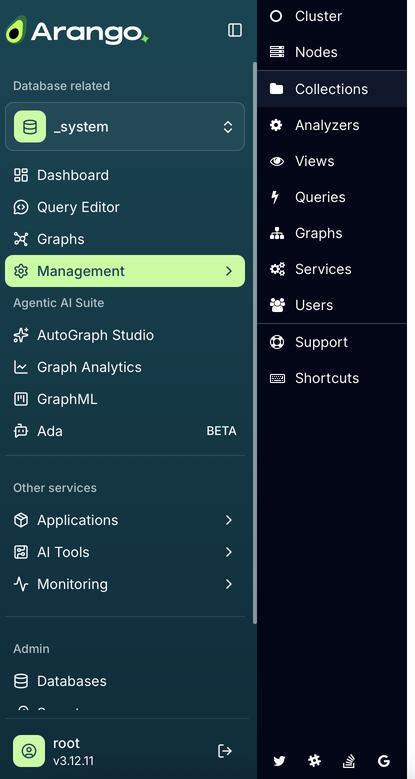

The sidebar of the [data platform web interface](_index.md) groups its entries
into sections. The tables below list the entries of each section in the order
they appear, with the icon that the sidebar shows for them.

## Database related

The views in this section work with the database that is selected in the
[database selector](_index.md#database-selector).

| Icon | Entry | What you do there | Learn more |
|:----:|:------|:------------------|:-----------|
|  | **Dashboard** | Check the health of the deployment, such as the status of the Coordinators, DB-Servers, and Agents, and how shards are distributed. | [Cluster](../../arangodb/3.12/components/web-interface/cluster.md) |
|  | **Query Editor** | Write, run, explain, and profile AQL queries in tabs, save queries, and generate or optimize queries with AI assistance. | [Query Editor](../query-editor.md) |
|  | **Graphs** | List, create, and delete named graphs, and open a graph in the Graph Visualizer. | [Graph Visualizer](../graph-visualizer.md) |
|  | **Management** | Open the administration views of the ArangoDB core database system, see [Management menu](#management-menu). | [Web Interface (ArangoDB)](../../arangodb/3.12/components/web-interface/_index.md) |

## Agentic AI Suite



| Icon | Entry | What you do there | Learn more |
|:----:|:------|:------------------|:-----------|
|  | **AutoGraph Studio** | Create projects that turn your documents into a Context Graph and deploy retrievers to answer questions from it. | [AutoGraph web interface](../autograph/web-interface.md) |
|  | **Graph Analytics** | Start Graph Analytics Engines and run graph algorithms such as PageRank on them. | [Graph Analytics web interface](../graph-analytics/web-interface.md) |
|  | **GraphML** | Create GraphML projects and run featurization, training, and prediction jobs. | [GraphML web interface](../graphml/ui.md) |
|  | **Ada** (beta) | Ask questions about your database in natural language and let the AI assistant run queries for you. | [Ada](../ada/_index.md) |

## Other services

These entries have sub-entries. Click an entry to expand it in the sidebar.

| Icon | Entry | Sub-entries | Learn more |
|:----:|:------|:------------|:-----------|
|  | **Applications** | **All apps**, followed by one entry per deployed app that has its own user interface. | [Apps](../container-manager/apps.md) |
|  | **AI Tools** | **Notebook servers** to run Jupyter notebooks, and **MLFlow** to track experiments and manage models. | [Notebook servers](../notebook-servers.md) |
|  | **Monitoring** | **Grafana** dashboards and **Prometheus** metrics. | [Monitoring](../monitoring.md) |

## Admin

| Icon | Entry | What you do there | Learn more |
|:----:|:------|:------------------|:-----------|
|  | **Databases** | List, create, and delete databases. | [Databases](../../arangodb/3.12/concepts/data-structure/databases.md) |
|  | **Secrets** | Store API keys and credentials, for example, for LLM providers, so that services can use them without exposing them. | [Secrets Manager](../secrets-manager.md) |
|  | **File Manager** | Review uploaded service packages and RAG input files, and delete the ones no service uses anymore. | [File Manager](../file-manager/_index.md) |
|  | **Container Manager** | Deploy your own services from code packages or container images and manage running instances. | [Container Manager web interface](../container-manager/web-interface.md) |

## Management menu

Clicking **Management** opens a second panel next to the sidebar with the
administration views of the ArangoDB core database system. These views work
with the database selected in the [database selector](_index.md#database-selector).

| Icon | Entry | What you do there | Learn more |
|:----:|:------|:------------------|:-----------|
|  | **Cluster** | View statistics and the health of the cluster. | [Cluster](../../arangodb/3.12/components/web-interface/cluster.md) |
|  | **Nodes** | List the Coordinators, DB-Servers, and Agents with their endpoints, versions, and status, and see how shards are distributed. | [Cluster](../../arangodb/3.12/components/web-interface/cluster.md) |
|  | **Collections** | List, create, and configure collections, and browse their documents. | [Collections](../../arangodb/3.12/components/web-interface/collections.md) |
|  | **Analyzers** | List and create Analyzers for full-text search. | [Analyzers](../../arangodb/3.12/indexes-and-search/analyzers.md) |
|  | **Views** | List and create `arangosearch` and `search-alias` Views. | [ArangoSearch](../../arangodb/3.12/indexes-and-search/arangosearch/_index.md) |
|  | **Queries** | Run AQL queries and review running and slow queries. | [Queries](../../arangodb/3.12/components/web-interface/queries.md) |
|  | **Graphs** | List and create named graphs, including SmartGraphs, SatelliteGraphs, and EnterpriseGraphs. | [Graphs](../../arangodb/3.12/components/web-interface/graphs.md) |
|  | **Services** | Install and manage Foxx microservices. | [Services](../../arangodb/3.12/components/web-interface/services.md) |
|  | **Users** | Create user accounts and manage their permissions. | [Users](../../arangodb/3.12/components/web-interface/users.md) |
|  | **Support** | Find links to the documentation, community, and support channels, and browse the HTTP API. | |
|  | **Shortcuts** | Look up the keyboard shortcuts of the web interface. | |

The icons at the bottom of the Management panel link to the Arango community
channels.
